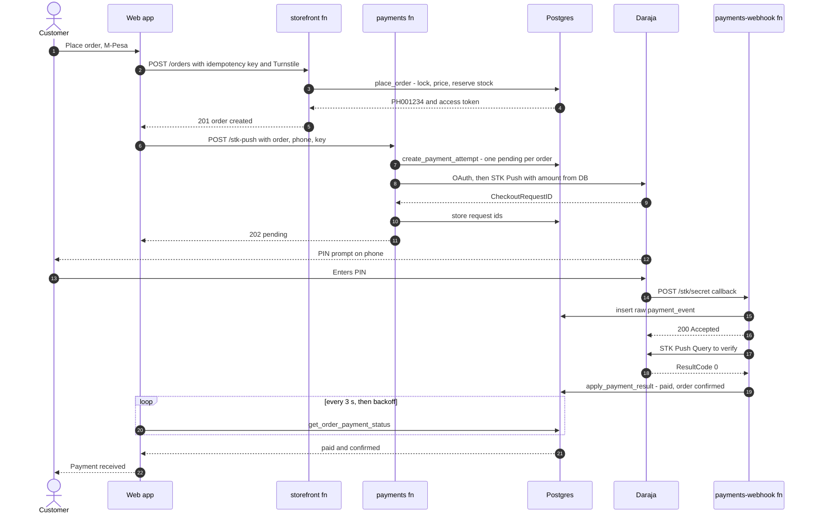
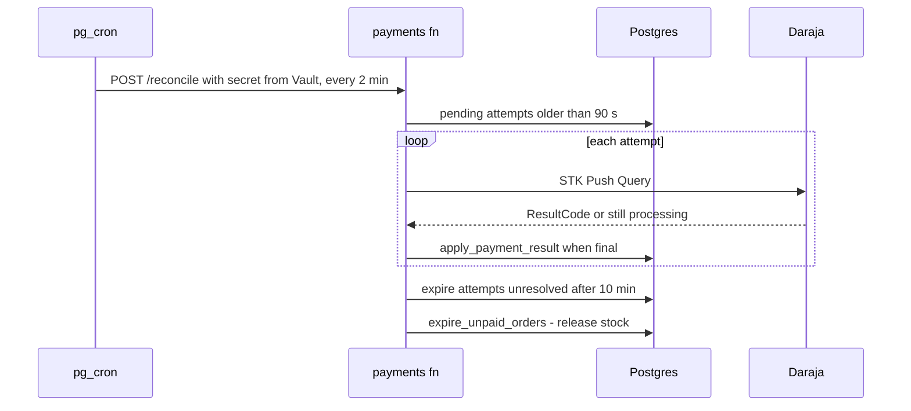

# API & Integrations: PoultryHub Kenya

> **Version:** 0.1 (Phase 0 design) · **Date:** 2026-10-13
> Related: [ARCHITECTURE.md](ARCHITECTURE.md) (structure), [DATABASE.md](DATABASE.md) (tables, functions, RLS).
> Third-party API details were checked against current documentation where it was available (Supabase docs, Oct 2026). Daraja field limits and result codes come from widely used integration references and **must be re-verified against the Daraja portal at integration time** (marked ⚠).

---

## 1. Overview

| Integration | Purpose | Phase | Cost | Credentials needed |
|---|---|---|---|---|
| Supabase (Postgres, Auth, Storage, Edge Functions, Realtime, Cron, Vault) | Backend platform | 3–7 | Free (dev/staging) · Pro from $25/month (production) | Project URL, publishable key, secret key, DB password, access token (CLI/CI) |
| Safaricom Daraja: M-Pesa Express (STK Push + Query) | Online payments | 4 (mock/sandbox) · 7 (production) | Safaricom transaction charges per business tariff | Consumer key/secret, shortcode, passkey, go-live approval |
| Cloudflare Turnstile | Bot protection (auth, guest checkout, contact, order lookup) | 3 | Free | Site key (public), secret key |
| Transactional email (Resend, Brevo, Amazon SES, …) | Auth emails (custom SMTP) and order emails | 3 (local viewer) · 7 | Free tier at launch volumes | SMTP credentials / API key, domain DNS |
| WhatsApp (`wa.me` deep links) | Customer contact | 2 | Free | Business WhatsApp number |
| Maps (Google Maps link or embed, no API key) | Location | 2 | Free | Shared map URL |
| Static host (Cloudflare recommended; Netlify/Vercel are alternatives) | Hosting, CDN, headers, rewrites, deploy hooks | 7 (previews earlier) | Free tier | Account, deploy hook URL |
| *Later:* Africa's Talking (SMS), Sentry (errors), Cloudflare Web Analytics, KRA eTIMS middleware | Optional | After launch | Varies | — |

## 2. Supabase client usage

**Browser client** (`src/lib/supabase/client.ts`, sketch):

```ts
export const supabase = createClient<Database>(env.VITE_SUPABASE_URL, env.VITE_SUPABASE_PUBLISHABLE_KEY, {
  auth: { flowType: 'pkce', persistSession: true, autoRefreshToken: true, detectSessionInUrl: true },
  global: { headers: { 'x-client-info': 'poultryhub-web' } },
});
```

- **Keys:**
  - Browser and build: the **publishable key** (`sb_publishable_…`). It's safe to expose; access is limited by RLS.
  - Edge Functions and CLI only: the **secret key** (`sb_secret_…`). It bypasses RLS. Supabase rejects secret keys sent with a browser User-Agent, but that is not a safety net.
  - Legacy `anon`/`service_role` JWT keys are **not used**; they are deprecated by the end of 2026.
- **Build-time (pre-render) client:** a separate stateless client (`persistSession: false`) used only by route loaders in Node. It reads public data under the `anon` role.
- **Edge Functions:**
  - A *user-scoped* client built from the caller's JWT is used for reads that should respect RLS.
  - An *admin* client using the secret key (`SUPABASE_SECRET_KEYS`, provided automatically) is used only for service-role functions such as `place_order` and `apply_payment_result`.
  - Callers are always authenticated in code with `supabase.auth.getClaims(jwt)`.
- **Auth configuration:**
  - Email + password with confirmation, and PKCE for confirmation, magic-link and recovery links.
  - Redirect allow-list: `{SITE_URL}/auth/callback` and `{SITE_URL}/auth/reset-password`, plus staging and local equivalents.
  - Turnstile captcha on sign-up, sign-in and password reset (native Supabase Auth feature).
  - Minimum password length 8; leaked-password protection on Pro.
  - Custom SMTP in production.

## 3. Data access contracts

Each service method (ARCHITECTURE §7.1) maps to one Supabase operation. Pages never call Supabase directly.

| Service method | Supabase operation |
|---|---|
| `catalog.listCategories()` | `from('categories').select('id,slug,name,description,image_path,parent_id').eq('is_active', true).order('sort_order')` |
| `catalog.listProducts(q)` | `from('storefront_products').select('…', { count: 'exact' })`, then `.eq('category_slug')`, `.textSearch('search_vector', q, { type: 'websearch', config: 'simple' })`, `.gte/.lte('min_price_minor')`, `.in('availability')`, `.order(…)`, `.range(from, to)` |
| `catalog.getProduct(slug)` | `from('products').select('*, category:categories(slug,name), variants:product_variants(*), images:product_images(*)').eq('slug', slug).maybeSingle()` |
| `catalog.listRelated(id)` | `storefront_products`, same category, `.neq('id', id).limit(4)` |
| `orders.quoteCart(input)` | `rpc('quote_cart', {...})` |
| `orders.placeOrder(input)` | `functions.invoke('storefront/orders', { body })` |
| `orders.getOrder({ orderNumber })` (signed in) | `from('orders').select('*, items:order_items(*), events:order_events(*), payments(id,status,amount_minor,method,mpesa_receipt_number,completed_at)').eq('order_number', n).single()` |
| `orders.getOrder({ orderNumber, token })` (guest) | `rpc('get_order_by_token', { order_number, token })` |
| `orders.listMyOrders(page)` | `from('orders').select('order_number,status,payment_status,total_minor,placed_at', { count: 'exact' }).order('placed_at', { ascending: false }).range(…)` |
| `orders.cancelPendingOrder(ref)` | `rpc('cancel_pending_order', …)` |
| `payments.startMpesaPayment(input)` | `functions.invoke('payments/stk-push', { body })` |
| `payments.getPaymentStatus(ref)` | `rpc('get_order_payment_status', …)` |
| `content.getBlock(key)`, `listFaqs()`, `listTestimonials()`, `listPosts()`, `getPost()`, `getPage()`, `getSettings()` | Table selects filtered by publish state (RLS enforces this too) |
| `delivery.listAreas(county)`, `listPickupLocations()`, `listZones()` | Table selects (active only) |
| `account.getProfile()`, `updateProfile()`, `addresses.*` | `profiles` / `addresses` under RLS |
| `contact.submit(input)` | `functions.invoke('storefront/contact', { body })` |
| `auth.*` | `supabase.auth.signUp / signInWithPassword / signOut({ scope }) / resetPasswordForEmail / updateUser / exchangeCodeForSession` |

The admin services (Phase 5) follow the same pattern. Writes to orders, payments, stock and roles go through RPCs; catalogue and content CRUD go directly to tables under admin RLS.

## 4. RPC semantics

SQL definitions are in [DATABASE §8](DATABASE.md#8-database-functions). This section covers the API behaviour clients rely on.

| RPC | Input → output | Errors (`AppError.code`) |
|---|---|---|
| `quote_cart` | `{ items: [{variant_id, quantity}], fulfilment, delivery_area_id?, pickup_location_id?, promo_code? }` → `{ lines: [{variant_id, unit_price_minor, quantity, line_total_minor, issues: []}], subtotal_minor, discount_minor, delivery_fee_minor, total_minor, delivery: {zone, eta_min_days, eta_max_days, free_over_minor}, promo: {code, applied, reason?}, issues: [] }` | Line issues: `UNAVAILABLE`, `INSUFFICIENT_STOCK` (with `available`), `QUANTITY_RULE` (with `min`, `step`, `max`), `PRICE_CHANGED`, `COLLECTION_ONLY` · Order issues: `AREA_NOT_SERVED`, `BELOW_MINIMUM_ORDER`, `PROMO_INVALID` |
| `get_order_by_token` | `{ order_number, token }` → order view (items, customer-visible events, payment summary, delivery/pick-up details) | `NOT_FOUND` (also returned for a wrong token, so the response gives nothing away) |
| `get_order_payment_status` | `{ order_number, token? }` → `{ status, payment_status, latest_attempt: {status, result_desc, created_at}, reserved_until }` | `NOT_FOUND` |
| `cancel_pending_order` | `{ order_number, token? }` → `{ status: 'cancelled' }` | `NOT_FOUND`, `NOT_CANCELLABLE` |

## 5. Edge Functions

**Common behaviour** (`supabase/functions/_shared`):

- **Requests:**
  - **CORS:** only origins in `ALLOWED_ORIGINS` (not applied to `payments-webhook`).
  - **Body:** JSON only, size limit 32 KB, validated with Zod schemas from `_shared/contracts`.
  - **Auth:** if an `Authorization: Bearer <jwt>` header is present, it is verified with `auth.getClaims()`. An invalid token gets `401`; it is never silently treated as a guest.
- **Responses:**
  - **Errors:** `{ "error": { "code": "…", "message": "…", "details"?: {…} } }` with the matching HTTP status. Stack traces are never returned.
  - **Logs:** structured, with `SB_EXECUTION_ID`; phone numbers are masked.
- **Configuration:**
  - **Secrets:** read through `_shared/env.ts`, which validates the required set for the active mode and fails closed.
  - **`verify_jwt = false`** for all functions in `config.toml`, with auth handled in code (ADR-008).

### 5.1 `storefront`

**`POST /storefront/orders`**: place an order.

```json
{
  "idempotencyKey": "6f1c3c9e-…",
  "turnstileToken": "…",
  "customer": { "name": "Jane Wanjiru", "phone": "0712 345 678", "email": "jane@example.com" },
  "items": [{ "variantId": "…", "quantity": 2 }],
  "fulfilment": {
    "method": "delivery",
    "deliveryAreaId": "…",
    "town": "Ruiru",
    "addressLine": "Kamakis, Greenfield Estate, House 14",
    "directions": "Gate opposite Shell petrol station",
    "instructions": "Call on arrival"
  },
  "paymentMethod": "mpesa_stk",
  "promoCode": null,
  "note": null,
  "expectedTotalMinor": 245000
}
```

`fulfilment` for pick-up is `{ "method": "collection", "pickupLocationId": "…" }`. `turnstileToken` is required for guests and optional for signed-in customers.

| Response | Body |
|---|---|
| `201` | `{ "orderNumber": "PH001234", "accessToken": "…", "status": "pending", "paymentStatus": "unpaid", "totalMinor": 245000, "nextAction": "mpesa_stk" \| "await_confirmation" \| "paybill_instructions", "trackingPath": "/orders/PH001234?token=…" }` |
| `200` | Same body with `"replayed": true`: an idempotent replay, which rotates the token (DATABASE §9.6) |
| `400` | `VALIDATION_FAILED` (field errors) |
| `403` | `CAPTCHA_FAILED` |
| `409` | `PRICE_CHANGED` (includes a fresh quote) · `INSUFFICIENT_STOCK` (lines) · `AREA_NOT_SERVED` · `PAYMENT_METHOD_UNAVAILABLE` · `PROMO_INVALID` · `IDEMPOTENCY_CONFLICT` |
| `429` | `TOO_MANY_OPEN_ORDERS` (BR-29) |

**`POST /storefront/orders/track`**: `{ orderNumber, phone, turnstileToken }` → `{ orderNumber, statusLabel, fulfilmentMethod, timeline: [{ type, label, at }] }`. It returns **no personal data** (CHK-07). `NOT_FOUND` comes back for any mismatch.

**`POST /storefront/contact`**: `{ name, phone?, email?, subject, message, orderNumber?, turnstileToken }` → `201 { ok: true }`. It inserts into `contact_messages` and optionally emails `CONTACT_ALERT_EMAIL`.

### 5.2 `payments`

**`POST /payments/stk-push`**: start (or retry) an M-Pesa STK Push for an order.

- **Request:** `{ orderNumber, accessToken?, phone, idempotencyKey }`. Auth is the owner's JWT, or `accessToken` for guests.
- **Order checks:** the order is `pending`; `payment_status ∈ {unpaid}` (or `pending`, in which case the current attempt is returned); the M-Pesa method is enabled.
- **Amount:** always `orders.total_minor / 100` read from the DB. It is never taken from the request.
- **Attempt:** `create_payment_attempt()` (relies on the unique pending index), then the Daraja request (§7.3), then the attempt is updated with `MerchantRequestID`/`CheckoutRequestID`.
- **Response:** `202 { paymentId, status: "pending", customerMessage, pollAfterMs: 3000 }`.
- **Errors:** `NOT_FOUND`, `ORDER_NOT_PAYABLE`, `PAYMENT_IN_PROGRESS` (with the existing `paymentId`), `INVALID_PHONE`, `PAYMENTS_DISABLED`, `PROVIDER_UNAVAILABLE` (Daraja down or timed out; the attempt is marked `failed` and the customer is offered Paybill).

**`POST /payments/reconcile`** (called by cron; header `x-reconcile-secret`):

1. For each `pending` attempt older than 90 s, call STK Push Query.
2. Apply the result with `apply_payment_result()`.
3. Mark attempts unresolved after 10 min as `expired`.
4. Call `expire_unpaid_orders()`.

Response: `{ checked, succeeded, failed, expired }`. Daraja rate-limit responses are retried on the next run.

**`POST /payments/mock/simulate`** (only when `PAYMENTS_MODE=mock` **and** `APP_ENV != production`; otherwise `404`):

- **Request:** `{ paymentId, outcome: "success" | "cancelled" | "insufficient_funds" | "timeout" | "late_success" }`.
- **Effect:** builds a Daraja-shaped callback and sends it through **the same processing path** as real callbacks. Receipts are prefixed `MOCK`.

### 5.3 `payments-webhook`

**`POST /payments-webhook/stk/<MPESA_CALLBACK_SECRET>`**: the Daraja STK callback (public; no CORS; no JWT).

1. Compare the secret path segment in constant time. A mismatch gets a `404` (no detail).
2. Parse defensively, then insert the raw event into `payment_events` (`verification = 'unverified'`).
3. Respond **`200 {"ResultCode":0,"ResultDesc":"Accepted"}`** immediately.
4. In the background (`EdgeRuntime.waitUntil`):
   - Match `CheckoutRequestID` to an attempt. If none matches, mark the event `matched = false` and stop; it appears in the admin queue.
   - If `ResultCode = 0`, **verify with STK Push Query**. Only then call `apply_payment_result(succeeded, receipt, amount, phone, date)`. The amount must equal the attempt amount; otherwise `needs_review`.
   - If `ResultCode ≠ 0`, apply the mapped failure status (§7.5).
   - The apply step locks the payment row and is a no-op if the payment is already final, so duplicate callbacks are harmless.
5. Any background failure leaves the attempt `pending`. **Reconciliation recovers it** within minutes.

The path deliberately avoids words such as "mpesa", "safaricom", "query", "sql", "exe" and "cmd". Daraja documentation lists these as forbidden in callback and confirmation URLs ⚠.

### 5.4 `admin` (Phase 5)

All routes require an admin JWT with `aal2` (if MFA is approved), checked in code.

- `POST /admin/team/invite` `{ email, role }`: `auth.admin.inviteUserByEmail`, then `grant_role`.
- `POST /admin/customers/:id/ban` `{ until | "none" }`: `auth.admin.updateUserById` (`ban_duration`).
- `POST /admin/customers/:id/delete`: anonymise (DATABASE §12), then `auth.admin.deleteUser`.

## 6. Error model

| Code | HTTP | Meaning | Customer copy (example) |
|---|---|---|---|
| `VALIDATION_FAILED` | 400 | Field errors in `details.fields` | "Please check the highlighted fields." |
| `UNAUTHENTICATED` | 401 | Missing or invalid session | "Please sign in again." |
| `FORBIDDEN` | 403 | Role or ownership check failed | "You don't have access to this." |
| `CAPTCHA_FAILED` | 403 | Turnstile invalid or expired | "Please complete the security check again." |
| `NOT_FOUND` | 404 | Unknown resource, or wrong token | "We couldn't find that order. Check the number and phone." |
| `PRICE_CHANGED` | 409 | Server total ≠ client's expected total | "Some prices changed. Please review your order." |
| `INSUFFICIENT_STOCK` | 409 | Not enough stock (lines listed) | "Only 4 trays left. We've updated your cart." |
| `QUANTITY_RULE` | 409 | MOQ, step or max violated | "Chicks are sold in multiples of 10 (minimum 50)." |
| `AREA_NOT_SERVED` | 409 | No active delivery rule | "We don't deliver there yet. Choose pick-up or chat with us on WhatsApp." |
| `BELOW_MINIMUM_ORDER` | 409 | Zone minimum not met | "Delivery to this area needs a minimum order of KSh 1,500." |
| `PAYMENT_METHOD_UNAVAILABLE` | 409 | Disabled or not allowed for this fulfilment or value | "Pay on delivery isn't available for this order." |
| `PROMO_INVALID` | 409 | Code invalid (reason in `details`) | "This code has expired." |
| `ORDER_NOT_PAYABLE` | 409 | Order not pending or already paid | "This order doesn't need payment." |
| `PAYMENT_IN_PROGRESS` | 409 | An attempt is already pending | "Check your phone: we've already sent a prompt." |
| `NOT_CANCELLABLE` | 409 | Order past pending | "This order can no longer be cancelled online. Please contact us." |
| `IDEMPOTENCY_CONFLICT` | 409 | Key reused with a different payload | (internal; client generates a new key) |
| `TOO_MANY_OPEN_ORDERS` | 429 | Open-order cap per phone | "You have unpaid orders waiting. Complete or cancel them first." |
| `PAYMENTS_DISABLED` | 503 | M-Pesa switched off | "M-Pesa is temporarily unavailable. Choose another payment method." |
| `PROVIDER_UNAVAILABLE` | 503 | Daraja error or timeout | "M-Pesa didn't respond. Try again or pay via Paybill." |
| `NETWORK` | — (client) | Request failed in transit | "No connection. Your cart is saved. Try again." |
| `INTERNAL` | 500 | Unexpected | "Something went wrong on our side. Please try again." |

## 7. M-Pesa (Daraja) integration

### 7.1 Prerequisites & go-live (business actions; start now, risk R1)

1. The business holds an M-Pesa **Paybill** or **Till (Buy Goods)** number, plus access to the M-Pesa **Organization Portal** (business administrator).
2. A Daraja account (`developer.safaricom.co.ke`) with an app that has **M-Pesa Express (STK Push)** enabled. Sandbox credentials are available immediately.
3. **Go-live:** submit the go-live request on Daraja for the shortcode. Safaricom then issues production consumer key/secret access and the **Lipa Na M-Pesa Online passkey**. Lead time is days to weeks.
4. A production callback URL on HTTPS: the deployed `payments-webhook` function on the production Supabase project.
5. Paybill vs Till ⚠:
   - **Paybill:** `TransactionType = CustomerPayBillOnline`; `BusinessShortCode = PartyB =` Paybill number.
   - **Till:** `TransactionType = CustomerBuyGoodsOnline`; `BusinessShortCode =` the store/head-office number; `PartyB =` the Till number.
   - Confirm the exact numbers with Safaricom at go-live.

### 7.2 Environments

| `PAYMENTS_MODE` | `MPESA_ENV` | Base URL | Use |
|---|---|---|---|
| `mock` | — | none (in-process) | Local development, CI, E2E. **Refused when `APP_ENV=production`** |
| `daraja` | `sandbox` | `https://sandbox.safaricom.co.ke` | Staging (needs a public callback, i.e., a deployed staging function) |
| `daraja` | `production` | `https://api.safaricom.co.ke` | Production only |

`payments.environment` records `mock`, `sandbox` or `production`. Reports and revenue use `production` only (BR-23), and admin shows **TEST** badges on everything else.

### 7.3 Requests

**OAuth.** `GET /oauth/v1/generate?grant_type=client_credentials` with Basic auth (`consumer_key:consumer_secret`). The token (about 1 hour) is cached in isolate memory and refreshed on `401` or near expiry.

**STK Push.** `POST /mpesa/stkpush/v1/processrequest`

| Field | Value |
|---|---|
| `BusinessShortCode` | `MPESA_SHORTCODE` |
| `Password` | `base64(Shortcode + Passkey + Timestamp)` |
| `Timestamp` | `YYYYMMDDHHmmss` in **EAT** |
| `TransactionType` | `MPESA_TRANSACTION_TYPE` |
| `Amount` | Whole shillings from the DB (`total_minor / 100`) |
| `PartyA`, `PhoneNumber` | Payer, `2547XXXXXXXX` / `2541XXXXXXXX` (E.164 without `+`) |
| `PartyB` | `MPESA_PARTY_B` |
| `CallBackURL` | `${MPESA_CALLBACK_BASE_URL}/stk/${MPESA_CALLBACK_SECRET}` |
| `AccountReference` | Order number, e.g. `PH001234` (≤ 12 chars ⚠) |
| `TransactionDesc` | Order number (≤ 13 chars ⚠) |

Expected response: `ResponseCode "0"`, `MerchantRequestID`, `CheckoutRequestID`, `CustomerMessage`. Any other response marks the attempt `failed` and shows the customer a fallback.

**STK Push Query** (verification and reconciliation). `POST /mpesa/stkpush/v1/query` with `BusinessShortCode`, `Password`, `Timestamp`, `CheckoutRequestID` → `ResultCode`, `ResultDesc`. A "still being processed" error means **leave the attempt pending** and retry later. The query response carries **no receipt number**: the receipt comes from the callback. If the query confirms success but no callback ever arrived, the payment is `succeeded` with the receipt marked *pending* and `review_status = 'needs_review'`, so an admin can add it from the M-Pesa statement.

All Daraja calls use a 15 s timeout (`AbortController`). Requests and responses are logged to `payment_events` with credentials and passwords stripped.

### 7.4 Callback payload (parsed fields)

`Body.stkCallback`: `MerchantRequestID`, `CheckoutRequestID`, `ResultCode`, `ResultDesc`, and on success `CallbackMetadata.Item[]` with `Amount`, `MpesaReceiptNumber`, `TransactionDate` (`YYYYMMDDHHmmss`, EAT) and `PhoneNumber`. The parser is a pure, runtime-agnostic function covered by unit tests. Unknown or missing items are tolerated and recorded.

### 7.5 Result-code mapping ⚠

| `ResultCode` | Meaning | Attempt status | Customer message |
|---|---|---|---|
| `0` | Success (after query verification) | `succeeded` | "Payment received. Thank you!" |
| `1032` | Cancelled by user | `cancelled` | "You cancelled the M-Pesa prompt. Try again when ready." |
| `1037` | No response from phone / timeout | `failed` | "We couldn't reach your phone. Make sure it's on and unlocked, then try again." |
| `1` | Insufficient balance | `failed` | "M-Pesa says the balance isn't enough. Top up and try again, or choose another method." |
| `2001` | Wrong PIN / invalid initiator info | `failed` | "The payment didn't go through (wrong PIN?). Please try again." |
| `1001` | Another transaction in progress for this subscriber | `failed` | "Another M-Pesa transaction is in progress on this phone. Wait a moment and retry." |
| `1019` | Transaction expired | `expired` | "The prompt expired. Send a new one." |
| `1025`, `9999` | Error sending the push | `failed` | "M-Pesa couldn't send the prompt. Try again or pay via Paybill." |
| other | Unknown | `failed` (+ logged) | "The payment didn't go through. Try again or pay via Paybill." |

### 7.6 Sequence: order to confirmed payment



### 7.7 Sequence: reconciliation



### 7.8 Security summary

| Threat | Control |
|---|---|
| Forged callback | Secret path + matching `CheckoutRequestID` + **independent STK Query verification** before anything is marked paid |
| Replay or duplicate callbacks | Raw events stored; `apply_payment_result` is idempotent (row lock, final-state no-op); unique `checkout_request_id` and `mpesa_receipt_number` |
| Amount tampering | Amount comes from the DB at initiation, and the callback amount must equal the attempt amount (else `needs_review`) |
| Double charging | One pending attempt per order (unique partial index), idempotency keys, UI lock while pending |
| Lost callbacks | Reconciliation every 2 minutes |
| Secrets exposure | Consumer key/secret and passkey exist only as Edge Function secrets, and are never logged |
| Source IP spoofing | Source IP is logged for information only. An optional allow-list (`MPESA_ENFORCE_IP_ALLOWLIST`) is off by default, because Safaricom's callback IP ranges are community-documented, not officially published, and may change |

### 7.9 Refunds and unmatched payments

- **Refunds (PAY-07):** an admin performs the reversal or refund in the M-Pesa Organization Portal, or pays out in cash, then records it with `record_refund` (amount, method, reference, reason). The order's `payment_status` updates and the customer sees a refund event. Automated Reversal/B2C APIs need additional Safaricom approval and initiator credentials, so they're out of scope (PAY-08).
- **Unmatched:** callbacks with an unknown `CheckoutRequestID`, and manually reported codes that match nothing, appear in the admin queue. `link_unmatched_payment` attaches them to an order, with an audit entry.

### 7.10 Go-live checklist (Phase 7)

- [ ] Production consumer key/secret, shortcode, `PartyB`, passkey and transaction type set as secrets on the **production** project.
- [ ] `MPESA_CALLBACK_SECRET` freshly generated (≥ 32 random bytes, URL-safe) and different from staging.
- [ ] Callback URL reachable over HTTPS and free of forbidden keywords.
- [ ] `PAYMENTS_MODE=daraja`, `MPESA_ENV=production`, `APP_ENV=production`; mock endpoint returns 404.
- [ ] Real low-value transaction (e.g., KSh 10 test product, hidden) paid, verified, appears with its receipt, then refunded and recorded.
- [ ] Reconciliation cron running in production; alert path for `needs_review` items agreed with the business.

## 8. Mock payment provider

- Active when `PAYMENTS_MODE=mock`. `/stk-push` returns `CheckoutRequestID = "ws_CO_MOCK_<uuid>"` with `environment = 'mock'`.
- **Development UI:** on the order page, a clearly styled **TEST CONTROLS** box (only in non-production builds with mock mode) offers *Simulate success / cancel / insufficient funds / timeout / late success*, which call `/payments/mock/simulate`.
- **Mock verification:** the provider's "STK Query" returns whatever outcome was simulated, so the verification code path runs exactly as in production.
- **Guards:**
  - The function refuses mock mode if `APP_ENV=production`.
  - The frontend refuses `VITE_DATA_SOURCE=mock` in production builds.
  - Mock payments never count as revenue (BR-23).
- In **Phase 2** (no backend), the mock *service* simulates the whole flow in the browser, with the banner "Demo: no payment is processed".

## 9. Cloudflare Turnstile

- **Widget** (explicit render, `appearance: interaction-only`) on: guest checkout submit, contact form, track-order form, and sign-up, sign-in and password reset (through Supabase Auth's native captcha support).
- **Server verification:** `POST https://challenges.cloudflare.com/turnstile/v0/siteverify` with `secret`, `response` and `remoteip`. Tokens are single-use and short-lived, so a failed submit re-renders the widget.
- **Development:** Cloudflare's documented test keys. Site key `1x00000000000000000000AA` (always passes) and secret `1x0000000000000000000000000000000AA` (always passes); `2x…` variants always fail, which the E2E failure tests use.
- **Privacy:** Turnstile is cookie-free by design. It's mentioned in the privacy notice.

## 10. Email

| Email | Sent by | When | Phase |
|---|---|---|---|
| Confirm sign-up, reset password, email change, (admin) invite | Supabase Auth via **custom SMTP** | Auth events | 3 (local viewer) / 7 (SMTP) |
| Order received (with tracking link) | `storefront` → provider API | After `place_order`, if the customer gave an email | 4 (S) |
| Payment confirmed, out for delivery / ready for pick-up, cancelled / refunded | DB event → function | Status changes | 4–5 (S) |
| New order / payment needs review / new contact message (to business) | Functions | Events | 4–5 (S) |

- **Local development:** the Supabase stack's mail viewer (Mailpit) captures all auth emails, so no SMTP is needed.
- **Production:** the Supabase built-in sender is **development-only and heavily rate-limited**, so a custom SMTP provider is mandatory. The sending domain needs SPF, DKIM and DMARC records.
- **Templates:** branded HTML plus a plain-text version. All transactional; no marketing without consent (REQUIREMENTS §8).

## 11. WhatsApp & phone

- **Deep links:** `https://wa.me/<E164 without +>?text=<url-encoded>`, built by `src/domain/whatsapp.ts` from `site_settings.whatsapp_phone`. Templates:
  - **Product enquiry:** "Hello PoultryHub, I'm interested in {product} ({variant}). {url}"
  - **Order help:** "Hello, I need help with order {orderNumber}."
  - **Wholesale:** "Hello, I'd like a quote for bulk {category} supply."
- **Calls:** `tel:+2547…` links.
- **No WhatsApp Business API at launch.** It would add cost and Meta verification; it's the future path for automated notifications.

## 12. Maps

- **Address and links:** the address text plus an "Open in Google Maps" link from `site_settings.map_url` / `pickup_locations.map_url`. No API key is needed.
- **Embed:** an optional click-to-load embed facade (a static preview tile first; the iframe loads on tap) to save mobile data. The iframe origin is allowed in CSP `frame-src`.

## 13. Scheduled jobs (pg_cron + pg_net + Vault)

See [DATABASE §11](DATABASE.md#11-triggers--scheduled-jobs).

- `payments-reconcile` posts to the `payments` function with the shared secret read from `vault.decrypted_secrets` (the secret is created per environment, never in migrations).
- The function compares the header in constant time.
- Each run writes a summary log line, and failures surface in Supabase logs.

## 14. Static hosting integration

**Rewrites (SPA fallback).** Serve real files first; otherwise rewrite to `/__spa-fallback.html` with status 200. Example (Cloudflare/Netlify-style `_redirects`): `/*  /__spa-fallback.html  200`. Phase 1 spike S1 confirms the exact rule for the chosen host.

**Caching**

| Path | Header |
|---|---|
| `/assets/*` (hashed) | `public, max-age=31536000, immutable` |
| HTML | `public, max-age=0, must-revalidate` (CDN may cache with purge on deploy) |
| `sitemap.xml`, `robots.txt` | 1 hour |

**Security headers** (`_headers` or equivalent):

```text
Strict-Transport-Security: max-age=63072000; includeSubDomains; preload
X-Content-Type-Options: nosniff
Referrer-Policy: strict-origin-when-cross-origin
Permissions-Policy: camera=(), microphone=(), geolocation=(), payment=()
X-Frame-Options: DENY
Content-Security-Policy: default-src 'self';
  script-src 'self' 'unsafe-inline' https://challenges.cloudflare.com;   # hash-based CSP evaluated in Phase 6
  style-src 'self' 'unsafe-inline';
  img-src 'self' data: blob: https://<project-ref>.supabase.co;
  font-src 'self';
  connect-src 'self' https://<project-ref>.supabase.co wss://<project-ref>.supabase.co;
  frame-src https://challenges.cloudflare.com https://www.google.com;
  frame-ancestors 'none'; base-uri 'self'; form-action 'self'
```

**Deploy hook.** The `request-rebuild` job calls the host's deploy hook (URL stored in Vault) when catalogue or blog content has changed, at most once every 10 minutes, plus a nightly build. Pre-rendered pages and the sitemap stay current without manual deploys.

## 15. Optional & future integrations

| Integration | Use | Notes |
|---|---|---|
| Africa's Talking SMS | Order status SMS; phone-OTP sign-in via Supabase **Send SMS hook** | Per-SMS cost; needs sender ID registration |
| Sentry (or similar) | Frontend and function error monitoring | PII scrubbing required; DPA disclosure |
| Cloudflare Web Analytics | Cookieless traffic analytics | Free; no consent banner needed for cookieless analytics (confirm in legal review) |
| KRA eTIMS | E-invoices | Via certified middleware or API, pending accountant's advice |
| Daraja C2B (register URL) | Automatic matching of manual Paybill payments (BillRefNumber = order number) | Removes manual verification; same webhook security model |
| WhatsApp Business Platform | Automated order notifications | Meta verification and per-conversation pricing |

## 16. Environment variables & secrets

The full list with placeholders is in [`.env.example`](.env.example).

| Name | Where set | Used by | Secret? |
|---|---|---|---|
| `VITE_APP_ENV` | `.env.local` / host env | Browser and build | No |
| `VITE_SITE_URL` | `.env.local` / host env | Canonical URLs, OG, sitemap | No |
| `VITE_DATA_SOURCE` | `.env.local` / host env | Service selection (`mock` \| `supabase`) | No |
| `VITE_SUPABASE_URL` | `.env.local` / host env | Browser and build | No |
| `VITE_SUPABASE_PUBLISHABLE_KEY` | `.env.local` / host env | Browser and build | No (public by design) |
| `VITE_TURNSTILE_SITE_KEY` | `.env.local` / host env | Widget | No |
| `SUPABASE_URL`, `SUPABASE_SECRET_KEYS`, `SUPABASE_PUBLISHABLE_KEYS`, `SUPABASE_JWKS`, `SUPABASE_DB_URL` | **Auto-provided** in Edge Functions | Functions | Yes (secret keys, DB URL) |
| `APP_ENV` | Function secrets | Mode guards | No |
| `ALLOWED_ORIGINS` | Function secrets | CORS | No |
| `PAYMENTS_MODE`, `MPESA_ENV`, `MPESA_TRANSACTION_TYPE` | Function secrets | Payments | No |
| `MPESA_CONSUMER_KEY`, `MPESA_CONSUMER_SECRET`, `MPESA_PASSKEY` | Function secrets | Daraja | **Yes** |
| `MPESA_SHORTCODE`, `MPESA_PARTY_B` | Function secrets | Daraja | No (but environment-specific) |
| `MPESA_CALLBACK_BASE_URL` | Function secrets | Callback URL builder | No |
| `MPESA_CALLBACK_SECRET` | Function secrets | Webhook path | **Yes** |
| `MPESA_ENFORCE_IP_ALLOWLIST`, `MPESA_ALLOWED_CALLBACK_CIDRS` | Function secrets | Optional allow-list | No |
| `RECONCILE_SECRET` | Function secrets **and** Vault | Cron → function | **Yes** |
| `TURNSTILE_SECRET_KEY` | Function secrets + Supabase Auth captcha settings | Verification | **Yes** |
| `EMAIL_API_KEY` | Function secrets | Transactional email | **Yes** |
| `EMAIL_FROM`, `ORDER_ALERT_EMAIL`, `CONTACT_ALERT_EMAIL` | Function secrets | Email | No |
| SMTP host, port, user, password | Supabase dashboard (Auth → SMTP) | Auth emails | **Yes** (password) |
| `SUPABASE_ACCESS_TOKEN`, `SUPABASE_DB_PASSWORD`, `SUPABASE_PROJECT_REF` | GitHub Environment secrets | CI migrations and deploys | **Yes** |
| Deploy hook URL | Vault | `request-rebuild` job | **Yes** |

- **Where function secrets live:**
  - **Local:** `supabase/functions/.env` (git-ignored).
  - **Hosted:** `supabase secrets set …` (secret names can't start with `SUPABASE_`).
- **Never prefix a secret with `VITE_`.** Vite would ship it to the browser.
