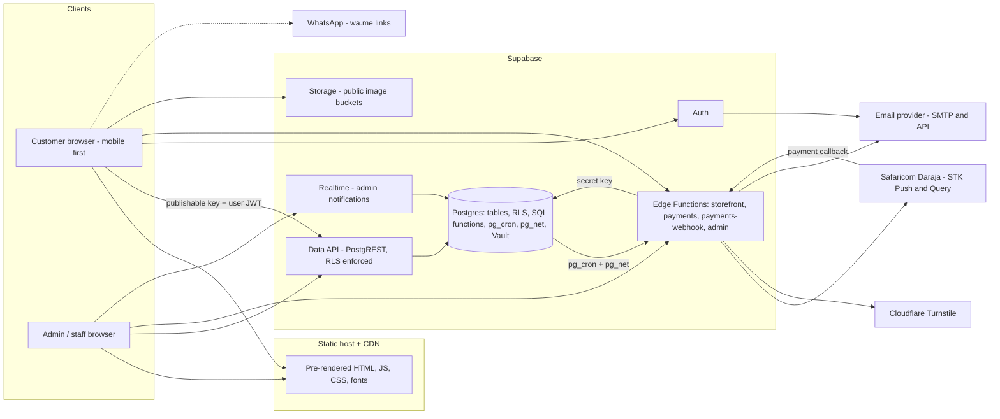

# Architecture: PoultryHub Kenya

> **Version:** 1.0 · **Date:** 2026-10-13 · **Status:** approved 2026-10-13 (decision D1 in [PLAN §9](PLAN.md#9-decisions-needed-from-you): framework mode with build-time pre-rendering)

---

## 1. System context



There is **no custom application server**. The site is static files on a CDN. Data access goes through Supabase's API, where RLS protects every row. Edge Functions run only where a secret, a third-party API or an abuse check is involved.

## 2. Principles

1. **The database is the source of truth for money, stock and permissions.** Constraints, RLS and transactional SQL functions enforce the business rules. The browser is untrusted.
2. **One seam between UI and data.** Pages depend on typed service contracts, never on Supabase directly. Mock implementations (Phase 2) and Supabase implementations (Phase 3+) are interchangeable.
3. **Static-first public site.** Pages are pre-rendered and served from the CDN. Interactive surfaces (cart, checkout, account, admin) run in the browser.
4. **Few moving parts.** Supabase plus a static host. Nothing is added unless a requirement needs it.
5. **Mobile and slow networks first.** Budgets are enforced, images are responsive, and every request has a failure path.
6. **Named rules over clever code.** Business rules have IDs (BR-xx) that appear in function comments and test names.

## 3. Technology stack

Versions were checked against the npm registry on **2026-10-13**. They will be pinned exactly in `package.json` (no `^`) with a committed `pnpm-lock.yaml`.

| Layer | Package | Version | Purpose / rationale |
|---|---|---|---|
| Runtime | Node.js | 24.x LTS (local 24.15.0) | Active LTS. Meets React Router 8 (≥ 22.22) and supabase-js (≥ 22) |
| Package manager | pnpm | 10.28.x (`packageManager` field) | Required. Strict, fast, with a reproducible lockfile |
| UI | `react`, `react-dom` | 19.3.0 | React 19: native metadata hoisting, actions |
| Routing / framework | `react-router`, `@react-router/dev`, `@react-router/node` | 8.4.0 | Framework mode (Vite plugin): route modules, `meta`, build-time pre-rendering, typed routes. `@react-router/node` is required even in SPA mode |
| Build | `vite` | 8.3.x | Fast dev server and production bundling |
| Language | `typescript` | **6.0.3** | **Not 7.x:** `typescript-eslint` 8.71 requires `>=4.8.4 <6.1.0`. Revisit when typed linting supports TS 7 |
| Styling | `tailwindcss`, `@tailwindcss/vite` | 4.3.x | CSS-first `@theme` tokens. No separate config file |
| Components | `shadcn` (CLI, development only), `radix-ui` | 4.21.x / 1.8.x | We own the copied component code. Radix provides accessible primitives |
| Utilities | `class-variance-authority`, `clsx`, `tailwind-merge` | 0.7.1 / 2.1.1 / 3.7.x | Component variants and class merging (shadcn standard) |
| Icons | `lucide-react` | 1.56.x | Consistent stroke icons. Brand icons (WhatsApp, etc.) are local SVGs |
| Animation | `motion` | 14.1.x | Motion for React (`motion/react`), loaded **only inside components that need exit or layout animation** (`<MotionScope>` with async `LazyMotion` features). Scroll reveals and hovers use CSS (spike S4, ADR-014) |
| Server state | `@tanstack/react-query` | 5.104.x | Caching, retries, background revalidation, polling |
| Forms | `react-hook-form`, `@hookform/resolvers`, `zod` | 7.90.x / 5.9.x / 4.6.x | Typed forms. The same Zod schemas validate Edge Function input |
| Client state | `zustand` | 5.0.x | The persisted cart, and almost nothing else |
| Dates | `date-fns` (+ `@date-fns/tz`, version checked at install) | 4.4.x | Formatting, and EAT day boundaries in reports |
| Backend SDK | `@supabase/supabase-js` | 2.117.x | Official client |
| Backend tooling | `supabase` (CLI, dev dependency) | 2.120.x | Local stack (Docker), migrations, type generation, function serving, pgTAP |
| Toasts | `sonner` | 2.0.x | shadcn's toast component |
| Markdown | `react-markdown` | 10.1.x | Blog, policies and FAQs. **No raw HTML** (safe by default) |
| Admin only | `@tanstack/react-table`, `recharts` | 9.3.x / 3.10.x | Data tables and charts. Lazy-loaded, never in public bundles |
| Fonts | `@fontsource-variable/plus-jakarta-sans` | 5.3.x | Self-hosted variable font. No third-party font request |
| Unit / component tests | `vitest`, `@testing-library/react`, `@testing-library/user-event`, `@testing-library/jest-dom`, `jsdom` | 5.0.x / 16.3.x / 14.6.x / 7.0.x / 30.x | Fast tests that share Vite's transform pipeline |
| E2E tests | `@playwright/test`, `@axe-core/playwright` | 1.64.x / 4.13.x | Cross-browser flows plus accessibility scans |
| Database tests | pgTAP via `supabase test db` | bundled | RLS and function tests inside Postgres |
| Lint / format | `eslint` **10.9.x**, `@eslint/js` 10.0.x, `typescript-eslint` 8.71.x, `eslint-plugin-react-hooks` 7.1.x, `eslint-plugin-jsx-a11y` 6.10.x, `prettier` 3.9.x, `prettier-plugin-tailwindcss` 0.8.x | — | **ESLint 10 (revised in Phase 1, ADR-003):** npm now marks ESLint 9 as unsupported. jsx-a11y 6.10.2 still declares ESLint ≤ 9, but a probe confirmed its rules run correctly on ESLint 10, so the peer range is allowed in `pnpm-workspace.yaml` until upstream ships support (jsx-a11y issue #1075) |

**Deliberately excluded**

- **`vaul`:** not published since Dec 2024. Drawers use Radix Dialog (the shadcn `Sheet`).
- **`@vitejs/plugin-react`:** React Router's Vite plugin handles the app. Vitest gets its own config without the React Router plugin.
- **The `cn` npm package:** the shadcn CLI now installs it by default. We keep the local `cn()` in `src/lib/utils.ts`, which extends tailwind-merge so custom utilities (`text-h2`, `shadow-card`) aren't dropped as conflicts.
- **Carousel libraries:** testimonials use CSS scroll-snap.
- **CSS-in-JS:** not needed.
- **Redux:** not needed.
- **Analytics SDKs:** none until a cookieless option is approved.

**Tooling notes**

- pnpm 10 blocks dependency install scripts by default. The `supabase` CLI package downloads its binary in a postinstall script, so it must be listed in `onlyBuiltDependencies` in `pnpm-workspace.yaml`.
- Node 26 should become LTS in late October 2026. We'll consider upgrading only after the whole toolchain supports it.

## 4. Rendering strategy (ADR-001)

**Context.** The requirements call for real SEO (Kenyan local search) and good link previews. Most product sharing in Kenya happens on **WhatsApp, whose link-preview crawler does not run JavaScript**, so a plain SPA would show the same generic preview for every product. The brief also asks for Vite + React and **no second framework**.

**Decision.** Use React Router 8 in **framework mode** with `ssr: false`, plus `prerender`:

| Rendering | Routes | Data |
|---|---|---|
| **Pre-rendered at build time** (static HTML + hydration) | `/`, `/shop`, `/shop/:categorySlug`, `/products/:productSlug`, `/about`, `/services`, `/contact`, `/faq`, `/track-order`, `/blog`, `/blog/:postSlug`, `/policies/*`, `/sitemap.xml`, `/robots.txt` | A route `loader` runs at **build time** (mock fixtures in Phase 2, Supabase publishable key from Phase 3). A `clientLoader` and TanStack Query fetch fresh data in the browser |
| **Client-rendered** (served by `__spa-fallback.html`) | `/search`, `/cart`, `/checkout`, `/orders/*`, `/auth/*`, `/account/*`, `/admin/*`, 404 | `clientLoader` and TanStack Query only |

The React Router docs (8.4) confirm the details this relies on:

- With `ssr:false` and `prerender`, loaders are allowed on pre-rendered routes.
- When `/` is pre-rendered, an SPA fallback file `__spa-fallback.html` is written for all other paths.
- `headers` and `action` exports are not allowed.

**Freshness.**

- **Prices and stock:** never trusted from HTML. TanStack Query refetches them on mount (`initialData` comes from build time, then revalidates).
- **New products and posts:** reachable immediately through the SPA fallback, and indexable after the next build.
- **Rebuilds:** triggered by a deploy hook when products or posts are published (debounced), plus a nightly rebuild (Phase 7).

**Constraints this imposes, enforced in review and lint:**

- Every route module must be **safe to render in Node**. No `window`, `localStorage` or `document` access during render; that work happens in effects or `useHydrated()`-gated components.
- State that only exists in the browser (cart count, signed-in state) renders as empty or signed-out in the HTML and fills in after hydration, so there's no hydration mismatch.
- No content may be invisible in the pre-rendered HTML. Animations start from visible content (see [DESIGN_SYSTEM §12](DESIGN_SYSTEM.md#12-motion-system)).

**Consequences.**

- **Benefits:** real HTML for crawlers and WhatsApp/Facebook previews, `meta` exports per route, automatic route code-splitting, typed route params, and hosting stays purely static.
- **Costs:** React Router framework conventions, a build-time dependency on the data source, a rebuild pipeline, and the hydration discipline above.

**Alternative (if D1 is declined): a plain SPA** using React Router's data mode. Simpler, but indexing is slower and link previews are generic. Adding per-product previews later would need host-specific edge middleware.

## 5. Project structure

```text
PoultryHub-Kenya/
├── .github/workflows/          # ci.yml (lint, typecheck, unit, build, e2e) · db.yml (pgTAP + integration)
├── docs/                       # design reference, runbooks, ADR details (Phase 7 handover)
├── e2e/                        # Playwright specs, fixtures, page objects
├── public/                     # favicons, manifest, static images + images/CREDITS.md (licences)
├── scripts/                    # one-off tooling (e.g., provision-admin.sql, perf budgets)
├── src/
│   ├── root.tsx                # document shell, providers, root ErrorBoundary, HydrateFallback
│   ├── routes.ts               # route config: the single source of truth for URLs
│   ├── routes/                 # thin route modules: meta, loader/clientLoader, compose features
│   │   ├── public/             # home, shop, category, product, about, services, contact, faq,
│   │   │                       # blog, policies, search, cart, checkout, orders, track-order
│   │   ├── auth/               # sign-in, sign-up, forgot/reset password, callback
│   │   ├── account/            # overview, orders, profile, addresses, security
│   │   ├── admin/              # one module per admin page (Phase 5)
│   │   └── system/             # not-found, access-denied, sitemap.xml, robots.txt, dev/design-system
│   ├── layouts/                # PublicLayout, CheckoutLayout, AccountLayout, AdminLayout
│   ├── components/
│   │   ├── ui/                 # shadcn/ui primitives (generated, themed, owned by us)
│   │   ├── layout/             # SiteHeader, MobileNav, SiteFooter, AnnouncementBar, Admin chrome
│   │   └── shared/             # Section, SectionHeading, PriceDisplay, StatusBadge, EmptyState,
│   │                           # ErrorState, QuantitySelector, Pagination, ConfirmDialog,
│   │                           # ResponsiveImage, WhatsAppLink, Reveal, JsonLd …
│   ├── features/               # feature modules (components, hooks, query keys, schemas, index.ts)
│   │   ├── catalog/  cart/  checkout/  orders/  payments/
│   │   ├── auth/  account/  content/  contact/
│   │   └── admin/              # dashboard, products, inventory, orders, customers, payments,
│   │                           # delivery, promotions, content, blog, messages, reports, settings
│   ├── services/
│   │   ├── contracts.ts        # service interfaces: the UI ↔ data seam
│   │   ├── index.ts            # picks the mock or Supabase implementation from env
│   │   ├── mock/               # Phase 2 implementations over fixtures (latency/error simulation)
│   │   └── supabase/           # Phase 3+ implementations + row ↔ domain mappers
│   ├── mocks/fixtures/         # SAMPLE data only; imported exclusively by services/mock
│   ├── domain/                 # pure TS business logic: money, phone, units/MOQ, status labels,
│   │                           # counties, cart rules (no React, no Supabase)
│   ├── lib/                    # supabase client, env validation, query client, seo, dates, cn()
│   ├── config/                 # site config (brand, nav, placeholders flagged), feature flags
│   ├── styles/                 # app.css: Tailwind 4 @theme tokens, base layer, utilities
│   ├── types/                  # domain types + database.types.ts (generated, committed)
│   └── test/                   # Vitest setup, render helpers, factories
├── supabase/
│   ├── config.toml
│   ├── migrations/             # timestamped SQL: schema + RLS + functions + storage + cron
│   ├── seed.sql                # local sample data (clearly marked SAMPLE)
│   ├── tests/                  # pgTAP: rls/*.test.sql, functions/*.test.sql
│   └── functions/
│       ├── _shared/            # cors, auth, errors, env, logging, turnstile, email,
│       │   └── contracts/      # runtime-agnostic Zod request/response schemas (shared with app)
│       ├── storefront/  payments/  payments-webhook/  admin/
├── .env.example  components.json  eslint.config.js  prettier.config.js
├── react-router.config.ts  vite.config.ts  vitest.config.ts  playwright.config.ts
├── tsconfig.json  package.json  pnpm-lock.yaml  pnpm-workspace.yaml  .nvmrc
└── PLAN.md  REQUIREMENTS.md  ARCHITECTURE.md  DESIGN_SYSTEM.md  DATABASE.md
    API_AND_INTEGRATIONS.md  TASKS.md  TESTING.md
```

**Layering rules** (enforced with ESLint `no-restricted-imports`; violations fail CI):

| Layer | May import | Must not import |
|---|---|---|
| `routes/*` | layouts, features, components, lib, config, types | `services/supabase`, `services/mock`, `mocks/*` directly |
| `features/*` | components, domain, services (through hooks), lib, config, types; other features **only via their `index.ts`** | another feature's internals |
| `components/*` | other components, domain (formatters), lib/utils, types | features, services |
| `services/*` | domain, lib, types, `@contracts/*` | React, components |
| `services/mock` | `mocks/fixtures` | — |
| `domain/*` | types only | React, Supabase, browser APIs |

## 6. Route map

### 6.1 Public and customer routes

| Path | Page | Render | Access | Indexed |
|---|---|---|---|---|
| `/` | Home | Pre-rendered | Public | Yes |
| `/shop` | All products (`?q=&category=&availability=&min=&max=&sort=&page=`) | Pre-rendered (default view), filtered in the browser | Public | Yes. Filtered URLs point their canonical at `/shop` or the category page |
| `/shop/:categorySlug` | Category listing | Pre-rendered for each active category | Public | Yes |
| `/products/:productSlug` | Product details | Pre-rendered for each active product; SPA fallback for new ones | Public | Yes |
| `/search` | Results for products, posts and FAQs | Client | Public | No (`noindex`) |
| `/cart` | Cart | Client | Public | No |
| `/checkout` | Checkout | Client | Guest or signed-in | No |
| `/orders/:orderNumber` | Confirmation, payment and tracking | Client | The owner's session, or `?token=` | No |
| `/track-order` | Find an order (number + phone) | Pre-rendered | Public | Yes |
| `/about`, `/services`, `/contact`, `/faq` | Content | Pre-rendered | Public | Yes |
| `/blog`, `/blog/:postSlug` | Blog | Pre-rendered | Public | Yes |
| `/policies/privacy`, `/policies/terms`, `/policies/delivery-and-returns`, `/policies/payments` | Policies | Pre-rendered | Public | Yes |
| `/auth/sign-in`, `/auth/sign-up`, `/auth/forgot-password`, `/auth/reset-password`, `/auth/callback` | Authentication | Client | Public | No |
| `/account`, `/account/orders`, `/account/profile`, `/account/addresses`, `/account/security` | Customer account | Client | Signed in | No |
| `/access-denied` | 403 | Client | — | No |
| `/sitemap.xml`, `/robots.txt` | SEO resource routes | Pre-rendered | Public | — |
| `*` | 404 | Client | — | No (`noindex`; static hosts return 200 for fallback paths, so this is a "soft 404") |
| `/dev/design-system` | Token and component gallery | Client | **Development builds only** | No |

### 6.2 Admin routes (client-rendered, `noindex`, Phase 5)

| Path | Module | Staff | Admin |
|---|---|---|---|
| `/admin` | Overview | ✓ operational metrics | ✓ including revenue |
| `/admin/orders`, `/admin/orders/:orderNumber` | Orders | ✓ | ✓ |
| `/admin/products`, `/admin/products/new`, `/admin/products/:productId` | Products & images | view | ✓ |
| `/admin/categories` | Categories | — | ✓ |
| `/admin/inventory`, `/admin/inventory/movements` | Inventory | ✓ | ✓ |
| `/admin/customers`, `/admin/customers/:customerId` | Customers | — | ✓ |
| `/admin/payments`, `/admin/payments/:paymentId` | Payments, review and unmatched queues | view | ✓ |
| `/admin/promotions` | Promo codes | — | ✓ |
| `/admin/delivery` | Zones, areas, pick-up points | view | ✓ |
| `/admin/content`, `/admin/content/faqs`, `/admin/content/testimonials`, `/admin/content/pages` | Content | — | ✓ |
| `/admin/blog`, `/admin/blog/new`, `/admin/blog/:postId` | Blog | — | ✓ |
| `/admin/messages` | Contact inbox | ✓ | ✓ |
| `/admin/reports` | Reports | — | ✓ |
| `/admin/settings`, `/admin/settings/team`, `/admin/audit-log` | Settings, team, audit | — | ✓ |

UI route guards exist **only for user experience**. Every read and write is enforced again by RLS and function checks ([DATABASE §9](DATABASE.md#9-row-level-security)).

## 7. Frontend architecture

### 7.1 Data access seam

```ts
// src/services/contracts.ts (sketch; final shapes in Phase 1)
export interface CatalogService {
  listCategories(): Promise<Category[]>;
  listProducts(query: ProductQuery): Promise<Page<ProductSummary>>;
  getProduct(slug: string): Promise<ProductDetail | null>;
  listRelated(productId: string, limit?: number): Promise<ProductSummary[]>;
}
export interface OrderService {
  quoteCart(input: CartQuoteInput): Promise<CartQuote>;          // authoritative totals
  placeOrder(input: PlaceOrderInput): Promise<PlacedOrder>;      // idempotent
  getOrder(ref: OrderRef): Promise<OrderDetail | null>;          // session or token
  listMyOrders(page: PageRequest): Promise<Page<OrderSummary>>;
  cancelPendingOrder(ref: OrderRef): Promise<void>;
}
export interface PaymentService {
  startMpesaPayment(input: StartMpesaInput): Promise<PaymentAttempt>;
  getPaymentStatus(ref: OrderRef): Promise<OrderPaymentStatus>;
}
export interface Services {
  catalog: CatalogService; orders: OrderService; payments: PaymentService;
  content: ContentService; delivery: DeliveryService; account: AccountService;
  auth: AuthService; contact: ContactService;
}
```

- `src/services/index.ts` picks the implementation from `VITE_DATA_SOURCE` (`mock` or `supabase`). Vite replaces that value at build time, so the unused implementation is tree-shaken. A CI check confirms the fixture marker string is **absent** from Supabase-mode production bundles.
- Domain types (camelCase) live in `src/types`. Supabase implementations map generated row types (snake_case) into them, so database naming never leaks into components.
- **Mock services** simulate latency (150–600 ms), validation errors, stock limits and failures, so every UI state can be shown in Phase 2 (`?mock=slow|empty|error`, development only).

### 7.2 Server state (TanStack Query)

| Data | Query key factory | `staleTime` | Notes |
|---|---|---|---|
| Categories, products, product detail | `catalogKeys.*` | 60 s | `initialData` from the pre-render loader. Prefetch product detail on hover or when a card scrolls into view |
| Content blocks, settings, FAQs, delivery config | `contentKeys.*`, `deliveryKeys.*` | 5 min | Rarely changes |
| Cart quote | `cartKeys.quote(lines, area, promo)` | 0 | Recomputed whenever the inputs change |
| Order detail / payment status | `orderKeys.*` | 0 | Payment polling: every 3 s for 2 min, then every 15 s up to 10 min, then manual refresh |
| Admin lists | `adminKeys.*` | 30 s | Realtime invalidates orders on insert |

- **Retries:** queries retry twice with exponential backoff, but not for 4xx errors. Mutations don't retry automatically; placing an order is safe to retry by hand because of its idempotency key.
- **Pagination and filters:** `placeholderData: keepPreviousData` so the grid doesn't flash.
- **Offline:** `onlineManager` drives an offline banner, and queries resume when the connection returns.

### 7.3 Client state

```ts
// src/features/cart/cart.store.ts (sketch)
type CartLine = {
  variantId: string;
  quantity: number;
  addedAt: string;                       // ISO timestamp
  snapshot: {                            // display only; never used for totals
    productSlug: string; productName: string; variantName: string;
    unit: SaleUnit; unitPriceMinor: number; imagePath?: string;
  };
};
// zustand + persist: key "phk-cart", version 1 with migrate(), skipHydration + rehydrate in an effect
```

Global client state is limited to the **cart** and a few UI flags. Sessions are managed by supabase-js; roles are fetched with TanStack Query. Checkout form drafts go into `sessionStorage` through a small hook.

### 7.4 Forms & validation

- React Hook Form with Zod resolvers.
- Field-level rules (phone, counties, quantities) live in `src/domain`.
- **Request schemas for Edge Functions** live in `supabase/functions/_shared/contracts/`. They are runtime-agnostic: a bare `zod` import resolves through pnpm in the app and through a `deno.json` import map in the functions. The app imports them via the `@contracts/*` alias, so **the checkout payload is defined once** (verified in Phase 4).
- Validation messages are specific and actionable: *"Enter a Kenyan mobile number, e.g. 0712 345 678"*.

### 7.5 Error handling

- **Error type:** all service errors are normalised to `AppError { code, message, retryable, details? }`. Codes are listed in [API_AND_INTEGRATIONS §6](API_AND_INTEGRATIONS.md#6-error-model). A single map turns codes into customer-facing copy.
- **Boundaries:** route `ErrorBoundary`s per layout show friendly recovery: retry, go home, or WhatsApp.
- **Logging:** errors go to the console in development. Production error monitoring is a Phase 6 decision.

### 7.6 Configuration

`src/lib/env.ts` validates `import.meta.env` with Zod when the app starts:

- **Supabase-mode inputs:** `VITE_SUPABASE_*` is required when `VITE_DATA_SOURCE=supabase`.
- **Production guard:** `VITE_DATA_SOURCE=mock` is **refused** when `VITE_APP_ENV=production`.
- **Secret-key guard:** any key starting with `sb_secret_` is rejected at startup, as a guard against pasting the wrong key.

In development, a full-screen configuration error lists missing variable **names**. It never prints values.

### 7.7 Authentication in the client

- **Session:** `AuthProvider` subscribes to `supabase.auth.onAuthStateChange`. `useSession()` and `useRoles()` (roles queried from `user_roles` under RLS) are used **only for UI** (menus, redirects).
- **Guards:** protected route groups use a layout `clientLoader` that redirects to `/auth/sign-in?next=…`, or to `/access-denied` when roles are missing.
- **Admin MFA:** if ADM-18 is approved, admin layouts require an `aal2` session and send the user to an enrol/verify step otherwise. RLS enforces the same `aal2` requirement on the server.

## 8. Backend architecture

### 8.1 Where logic lives

| Concern | Mechanism | Examples |
|---|---|---|
| Who may read or write which rows | RLS policies + explicit table and column grants | Customers read their own orders; the public reads active products |
| Invariants | Constraints, enums, foreign keys, triggers | `stock_quantity >= 0`; totals add up; one default variant per product |
| Multi-step business operations | Transactional SQL functions (`SECURITY DEFINER`, `search_path = ''`) | `place_order`, `update_order_status`, `adjust_stock`, `apply_payment_result` |
| Secrets, third-party APIs, captcha, email | Edge Functions (Deno) | Daraja STK and query, Turnstile verification, transactional email |
| Time-based work | `pg_cron` (calling Edge Functions through `pg_net`, with secrets from Vault) | Reconcile payments, expire holds, purge old data |
| UX validation and display | Frontend (Zod) | Phone formats, minimum-order hints. **Never authoritative** |

### 8.2 Edge Functions

| Function | Routes | Caller auth | `verify_jwt` |
|---|---|---|---|
| `storefront` | `POST /orders`, `POST /orders/track`, `POST /contact` | Anonymous, or the user's JWT verified in code. Turnstile for guests | `false` (auth handled in code) |
| `payments` | `POST /stk-push`, `POST /reconcile`, `POST /mock/simulate` (development only) | Order owner (JWT) or guest token; a cron secret for `/reconcile` | `false` |
| `payments-webhook` | `POST /stk/<secret>` | Safaricom. A secret path segment plus pull verification | `false` |
| `admin` (Phase 5) | `POST /team/invite`, `POST /customers/:id/ban` | Admin JWT with `aal2`, checked in code | `false` |

All four set `verify_jwt = false` deliberately. The new publishable and secret keys **are not JWTs**, so the platform check can't authenticate callers anyway (per Supabase's API keys docs). Every function authenticates explicitly with `supabase.auth.getClaims()` and role checks. Details: [API_AND_INTEGRATIONS §5](API_AND_INTEGRATIONS.md#5-edge-functions).

### 8.3 Scheduled jobs

| Job | Schedule | Action |
|---|---|---|
| `payments-reconcile` | every 2 min | Calls `payments/reconcile`. Runs STK Query on attempts pending for more than 90 s, applies the results, and expires attempts older than 10 min |
| `expire-unpaid-orders` | every 5 min | Cancels pending M-Pesa orders past `reserved_until` that have no in-flight attempt; releases stock (BR-09) |
| `purge-expired-data` | daily 02:00 EAT | Applies the retention schedule ([DATABASE §12](DATABASE.md#12-deletion-archival--retention)) |
| `request-rebuild` | every 10 min (Phase 7) | If catalogue or blog content changed, calls the host's deploy hook once |

### 8.4 Realtime and Storage

- **Realtime:** used only by staff and admin, for new orders and payment-review events. RLS applies to realtime subscriptions too.
- **Storage:** two public-read buckets (`product-images`, `site-media`). Only admins can write, enforced by policies on `storage.objects`. No private buckets in this version.

## 9. Security architecture

**Trust boundaries**

| Boundary | Untrusted input | Controls |
|---|---|---|
| Browser → Data API | Every query and RPC argument | RLS on every table, column grants, `SECURITY DEFINER` functions with internal role checks, explicit `EXECUTE` grants (defaults revoked) |
| Browser → Edge Functions | Bodies, headers, tokens | Zod validation, size limits, CORS allow-list, JWT verification in code, Turnstile, caps per phone |
| Safaricom → webhook | Callback bodies (unsigned) | Secret path, stored raw for audit, matched against our CheckoutRequestID and amount, **verified with STK Query** before applying, idempotent |
| Cron → Edge Functions | Scheduled calls | Shared secret from Vault in a header, constant-time comparison |
| Admin users | Elevated actions | Role table plus RLS, `aal2` (if approved), audit log, last-admin protection |

**Other controls**

- **Secrets:** only `VITE_` variables reach the browser, and they hold public values only. Edge secrets are set with `supabase secrets set`. Cron secrets live in Supabase Vault. CI fails if `sb_secret_` or Daraja variable names appear in the build output.
- **Content:** Markdown is rendered without raw HTML. User input is never injected as HTML.
- **Headers and CSP** are set on the static host ([API_AND_INTEGRATIONS §14](API_AND_INTEGRATIONS.md#14-static-hosting-integration)). Pre-rendered pages contain React Router's inline hydration scripts, so a hash-based CSP is evaluated in Phase 6. Until then the fallback is `script-src 'self' 'unsafe-inline'` with strict `connect-src`, `frame-src` and `img-src`.
- **Sessions:** supabase-js stores sessions in `localStorage`, so XSS prevention (above) is the main defence. Access tokens are short-lived, and "sign out of all devices" is available.
- **Privacy:** phone numbers are masked in logs (`2547****678`), PII is never sent to third parties except as each integration requires, and payment credentials are never collected.

## 10. Performance strategy

- **Static and cached:** pre-rendered HTML and hashed assets are cached on the CDN; hashed files are cached for a year as immutable.
- **Code splitting:** per route automatically. Admin, `recharts` and `@tanstack/react-table` load only under `/admin`.
- **Lean animation:** `LazyMotion` + `domAnimation` with `m` components (about 15 KB instead of the full bundle). CSS handles simple hovers and transitions.
- **Images:**
  - **Responsive:** `srcset`/`sizes` from 480/960/1600 px variants; WebP, with AVIF for the hero.
  - **Loading:** `loading="lazy"` below the fold; `fetchpriority="high"` and a preload for the LCP hero image.
  - **No layout shift:** explicit `width`/`height`.
- **Fonts:** one self-hosted variable font, Latin subset only, preloaded, `font-display: swap`.
- **Data:** aggregated RPCs (`quote_cart`) and views keep round trips down. Queries select only the columns they need.
- **Budgets:** enforced in CI for public route JS (≤ 170 KB gzipped). Lighthouse is checked on every phase gate.
- **Measured at the end of Phase 1:**
  - **Per page:** 136 KB (SPA fallback) to 155 KB (product pages) of initial JS, gzipped.
  - **Fixed cost:** React and React Router account for ~92 KB of that; TanStack Query ~11 KB; tailwind-merge ~9 KB.
  - **Headroom:** about 15 KB is left for Phase 2 public features, so the cart drawer, filters and similar must load on demand.

## 11. SEO strategy

- **Metadata:** a route `meta` export per page: title template `"{Page} | PoultryHub Kenya"`, description, canonical URL (absolute, from `VITE_SITE_URL`), Open Graph and Twitter cards.
- **Indexing:** private and transactional pages are `noindex`; `robots.txt` disallows `/admin`, `/account`, `/checkout`, `/cart`, `/orders`, `/auth` and `/search`.
- **Structured data:** JSON-LD through React Router's `"script:ld+json"` meta descriptor.
  - **Business:** `Organization`/`LocalBusiness`, including **only fields the business has supplied** (no invented ratings, address or geo).
  - **Products:** `Product` + `Offer` (price, currency KES, availability, URL).
  - **Navigation and content:** `BreadcrumbList`, `BlogPosting`, `FAQPage`.
- **Sitemap:** a pre-rendered `/sitemap.xml` generated from the same path list as `prerender`, with `lastmod`.
- **Page language:** `lang="en-KE"`. URLs are lowercase kebab-case slugs. Internal links go category → product → related products, and blog → products.

## 12. Observability & operations

- **Edge Functions:** structured JSON logs (`level`, `fn`, `route`, `executionId` from `SB_EXECUTION_ID`, `orderNumber`, masked phone) in Supabase logs.
- **Payments:** every provider request, response and callback is stored in `payment_events`. Admin queues show *needs review* and *unmatched* payments.
- **Database:** the Supabase dashboard advisors (security and performance) are checked every phase.
- **Optional:** error monitoring (e.g., Sentry with PII scrubbing) and cookieless analytics (e.g., Cloudflare Web Analytics). Both are Phase 6 decisions.

## 13. Environments, deployment & CI/CD

| Environment | Frontend | Supabase | Payments | Email | Turnstile |
|---|---|---|---|---|---|
| **Local** | `pnpm dev` | Docker stack via the CLI (`pnpm db:start`) | Mock provider | Local mail viewer (Mailpit) | Cloudflare test keys |
| **Staging** | Host preview deployments | Separate Supabase project (Free) | Daraja **sandbox** (needs a public callback URL) | Provider sandbox or test domain | Real keys (staging site) |
| **Production** | Static host + custom domain | Supabase **Pro** project, region chosen after the latency test | Daraja **production** | Custom SMTP with SPF/DKIM/DMARC | Real keys |

**CI (GitHub Actions)**

- `ci.yml` (PRs and `main`):
  - Install: `pnpm install --frozen-lockfile`.
  - Static checks: `lint` → `typecheck` → `test` (unit and component).
  - Build: `build` (mock data) → bundle-budget and secret scan.
  - E2E: Playwright against `preview`, with axe.
- `db.yml` (PRs touching `supabase/**`): `supabase start` → `supabase db reset` → `supabase test db` (pgTAP) → integration tests (oversell, payment webhook in mock mode).
- **Deploy:**
  - Frontend: the host's Git integration makes PR previews; production deploys from `main`.
  - Database: migrations go out through a manual `workflow_dispatch` job (`supabase db push`) behind a GitHub Environment approval.
  - Secrets: kept in GitHub Environments, never in the repo.

## 14. Architecture decision records

### 14.1 ADR log

| ADR | Decision | Status |
|---|---|---|
| ADR-001 | React Router 8 framework mode, `ssr:false`, build-time pre-rendering of public routes (§4) | Accepted (D1) |
| ADR-002 | TypeScript 6.0.3, not 7.x, until typescript-eslint supports TS 7 | Accepted |
| ADR-003 | ~~ESLint 9.39.x~~ **Revised in Phase 1:** ESLint 10.9 with jsx-a11y 6.10.2 under a documented peer-range override, because npm marks ESLint 9 unsupported and jsx-a11y was verified to work on 10 | Accepted (revised 2026-10-13) |
| ADR-004 | Money is `bigint` minor units, whole shillings, KES only | Accepted |
| ADR-005 | Products → variants. Unit, price, MOQ, step and stock live on the variant | Accepted |
| ADR-006 | Reserve stock when the order is placed. Unpaid M-Pesa orders get a TTL. Stock changes go through a ledger, with row locks taken in a fixed order | Accepted |
| ADR-007 | Roles in a `user_roles` table checked by RLS helper functions, not JWT claims, so revocation is immediate | Accepted |
| ADR-008 | Edge Functions use `verify_jwt=false` and authenticate in code (the new API keys aren't JWTs) | Accepted |
| ADR-009 | No `vaul`; Radix Dialog sheets for drawers | Accepted |
| ADR-010 | Images resized in the browser at upload; no paid image transformations | Accepted |
| ADR-011 | Guest checkout with hashed access tokens, Turnstile, holds and per-phone caps | Accepted (D4) |
| ADR-012 | Supabase publishable/secret keys from day one; legacy keys never used | Accepted |
| ADR-013 | An order is paid only after callback + STK Query verification or a staff record | Accepted |
| ADR-014 | Motion is scoped to on-demand components (`<MotionScope>`); scroll reveals use CSS + IntersectionObserver. App-wide Motion cost ~20 KB gzip on every page (spike S4) | Accepted (Phase 1) |
| ADR-015 | Initial-bundle discipline: no app-wide tooltip provider (each tooltip carries its own), toasts and the mobile menu sheet load on demand, env validation without Zod. Took public pages from ~230 KB to ≤ 156 KB gzip | Accepted (Phase 1) |

### 14.2 Phase 1 spikes

All four spikes ran in Phase 1 (2026-10-13). Evidence is in `e2e/foundation.spec.ts` and `scripts/check-bundle-budget.mjs`.

| Spike | Question | Pass criterion | Result |
|---|---|---|---|
| **S1** | Does a product slug that wasn't pre-rendered, served by `__spa-fallback.html`, load correctly through `clientLoader`, while pre-rendered slugs hydrate from build-time data? | Both paths render the right product with no console errors; client navigation between them works | ✅ **Pass.** Pre-rendered pages carry the product and its `Product` JSON-LD in the raw HTML. A slug added after the build is served by the fallback, and `clientLoader` runs automatically; no `clientLoader.hydrate` flag is needed. Client navigation between both kinds works without reloads, and unknown slugs reach the route error boundary as a 404 |
| **S2** | Can the persisted cart count and signed-in header state hydrate without mismatch warnings? | No hydration warnings; the badge updates after hydration without layout shift | ✅ **Pass.** Zustand `persist` with `skipHydration`, rehydrated in an effect, plus `useHydrated()` gating. The badge appears after hydration and survives reloads with zero console or hydration errors |
| **S3** | Can `sitemap.xml` and `robots.txt` be pre-rendered resource routes? | Valid files in `build/client`. Otherwise, a post-build script | ✅ **Pass.** Resource routes with loaders are written as static files. Non-production builds emit `Disallow: /` |
| **S4** | What does Motion cost on public routes with `LazyMotion` + `domAnimation`? | Within the 170 KB public-route budget | ⚠️ **Failed as designed, then fixed.** App-wide Motion cost ~20 KB gzip. Together with other app-wide modules, public pages reached ~230 KB. Resolved by ADR-014 and ADR-015, bringing every public page to **136–155 KB** |
