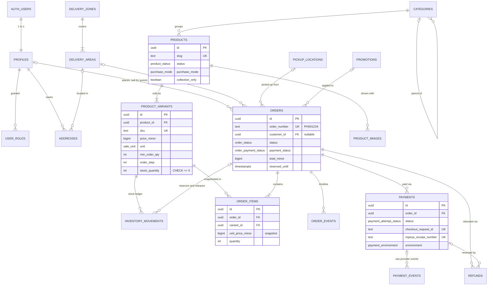
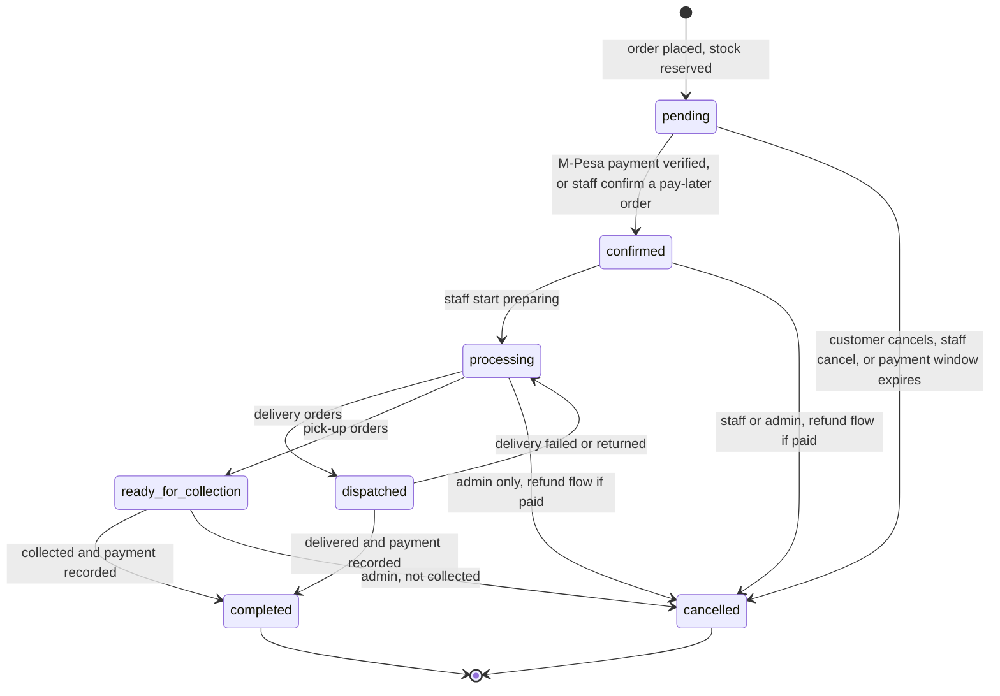
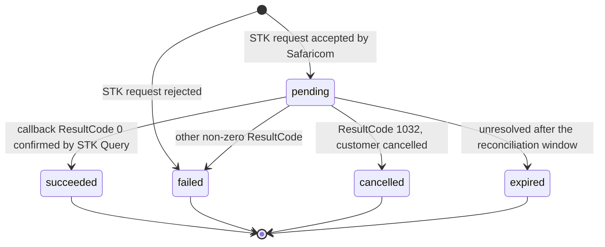

# Database: PoultryHub Kenya (Supabase Postgres)

> **Version:** 0.1 (Phase 0 design) · **Date:** 2026-10-13
> This is the **approved-design target** for the migrations written in Phases 3–5. Column lists are the intended model; exact DDL is finalised in migrations and kept in sync with this document.
> Business rule IDs (BR-xx) refer to [REQUIREMENTS §5](REQUIREMENTS.md#5-business-rules).

---

## 1. Conventions

| Topic | Convention |
|---|---|
| Schemas | `public`: application tables, views and RPCs exposed through the Data API. `private`: helper functions, **not** exposed. Supabase-managed: `auth`, `storage`, `cron`, `net`, `vault` |
| Naming | `snake_case`, plural table names, `*_id` foreign keys, `*_at` timestamps, `is_*` booleans, `*_minor` money |
| Primary keys | `uuid default gen_random_uuid()` for entities. `bigint generated always as identity` for append-only logs (`inventory_movements`, `order_events`, `payment_events`, `audit_logs`) |
| Money | `bigint` **minor units** (1 KES = 100). Customer prices, delivery fees and fixed discounts must be whole shillings (`CHECK (x % 100 = 0)`, BR-02). Currency is `'KES'` only (`CHECK`) |
| Time | `timestamptz` stored in UTC. Displayed and reported in `Africa/Nairobi` (EAT, UTC+3). Daily reports use `date_trunc('day', ts at time zone 'Africa/Nairobi')` |
| Phone | E.164 Kenyan mobile: `CHECK (phone ~ '^\+254(1\|7)[0-9]{8}$')`. Normalised in the app and re-checked in SQL |
| Email / codes | `citext` for case-insensitive emails and promo codes |
| Enums | Postgres enums for closed, stable sets (statuses, units, roles, counties). Values are only ever **added** (`ALTER TYPE … ADD VALUE`), never removed |
| `updated_at` | Maintained by a shared `set_updated_at()` trigger on every mutable table |
| Deletion | Commercial and financial records are **never hard-deleted**. Catalogue items are archived (§12) |
| Changes | **Migrations only** (`supabase/migrations`). No manual dashboard schema edits. Types are regenerated after every migration |
| Security | RLS is enabled **in the same migration** that creates the table. Grants are explicit (§9.4) |

## 2. Entity-relationship diagram



**Standalone tables** (no foreign keys to commerce data): `site_settings` (singleton), `content_blocks`, `pages`, `faqs`, `testimonials`, `blog_posts` (optional author → `profiles`), `contact_messages`, `audit_logs`.

**Deliberately not created:**

| Table | Why not |
|---|---|
| `carts` / `cart_items` | The cart lives on the device and is re-priced by `quote_cart` |
| `newsletter_subscriptions` | Deferred |
| `product_reviews` | Out of scope |
| `counties` | An enum is enough for a constitutionally fixed list |
| `inventory_levels` | Stock lives on the variant; see §7 for the trade-off |

## 3. Enumerated types

| Enum | Values |
|---|---|
| `app_role` | `admin`, `staff` |
| `product_status` | `draft`, `active`, `archived` |
| `purchase_mode` | `cart`, `enquiry` |
| `sale_unit` | `tray`, `crate`, `dozen`, `piece`, `chick`, `bird`, `bag`, `kg`, `litre`, `pack` |
| `inventory_reason` | `initial_stock`, `restock`, `order_reserved`, `order_released`, `mortality`, `damage`, `customer_return`, `count_correction` |
| `kenya_county` | The 47 counties (Mombasa … Nairobi) |
| `fulfilment_method` | `delivery`, `collection` |
| `order_status` | `pending`, `confirmed`, `processing`, `ready_for_collection`, `dispatched`, `completed`, `cancelled` |
| `order_payment_status` | `unpaid`, `pending`, `paid`, `partially_refunded`, `refunded` |
| `payment_method` | `mpesa_stk`, `mpesa_paybill`, `pay_on_delivery`, `pay_on_collection` |
| `payment_provider` | `daraja`, `mock`, `manual` |
| `payment_environment` | `production`, `sandbox`, `mock` |
| `payment_attempt_status` | `pending`, `succeeded`, `failed`, `cancelled`, `expired` |
| `review_status` | `none`, `needs_review`, `resolved` |
| `refund_method` | `mpesa`, `cash`, `bank`, `other` |
| `refund_status` | `pending`, `completed`, `cancelled` |
| `discount_type` | `percentage`, `fixed_amount` |
| `content_status` | `draft`, `published` |
| `contact_subject` | `general`, `order_help`, `wholesale_quote`, `farm_visit`, `feedback`, `other` |
| `contact_status` | `new`, `in_progress`, `resolved`, `spam` |

## 4. Tables

### 4.1 Identity & access

**`profiles`**: one row per Auth user, created by an `auth.users` insert trigger. It holds **no role or permission fields**.

| Column | Type | Constraints / notes |
|---|---|---|
| `id` | uuid | PK, FK → `auth.users(id)` on delete cascade |
| `full_name` | text | not null, 2–120 chars |
| `phone` | text | E.164 check, nullable |
| `email` | citext | Copied from `auth.users` by trigger, for admin search. **Not updatable** through the API |
| `marketing_opt_in` | boolean | default `false` (explicit consent) |
| `marketing_opt_in_at` | timestamptz | set when consent is given, cleared when withdrawn |
| `created_at`, `updated_at` | timestamptz | — |

**`user_roles`**: the only place privileges live.

| Column | Type | Constraints / notes |
|---|---|---|
| `user_id` | uuid | FK → `profiles(id)` on delete cascade |
| `role` | `app_role` | — |
| `granted_by` | uuid | FK → `profiles(id)` on delete set null |
| `created_at` | timestamptz | — |
| | | **PK (`user_id`, `role`)**. Written only by `grant_role` / `revoke_role` (BR-33) |

**`addresses`**: a customer's saved delivery addresses (ACC-05).

| Column | Type | Constraints / notes |
|---|---|---|
| `id` | uuid | PK |
| `user_id` | uuid | FK → `profiles(id)` on delete cascade |
| `label` | text | ≤ 40 chars ("Home", "Shop") |
| `recipient_name`, `phone` | text | Phone uses the E.164 check |
| `county` | `kenya_county` | not null |
| `delivery_area_id` | uuid | FK → `delivery_areas(id)` on delete set null |
| `town`, `address_line` | text | Estate, street or building |
| `directions` | text | Landmarks, ≤ 500 chars |
| `is_default` | boolean | Partial unique index (`user_id`) where `is_default` |
| `created_at`, `updated_at` | timestamptz | — |
| | | Trigger limits each user to 10 addresses |

### 4.2 Catalogue

**`categories`**

| Column | Type | Constraints / notes |
|---|---|---|
| `id` | uuid | PK |
| `parent_id` | uuid | FK → `categories(id)` on delete set null. `CHECK (parent_id <> id)`. A trigger limits depth to 2 |
| `slug` | text | unique, `^[a-z0-9]+(-[a-z0-9]+)*$`, ≤ 80 |
| `name`, `description` | text | — |
| `image_path` | text | `site-media` bucket path |
| `sort_order`, `is_active` | int, boolean | — |
| `seo_title`, `seo_description` | text | ≤ 70 and ≤ 160 chars |
| `created_at`, `updated_at` | timestamptz | — |

**`products`**: the presentation and grouping level. Price and stock live on variants.

| Column | Type | Constraints / notes |
|---|---|---|
| `id` | uuid | PK |
| `category_id` | uuid | FK → `categories(id)` **on delete restrict** |
| `slug` | text | unique, kebab-case |
| `name` | text | ≤ 120 |
| `short_description` | text | ≤ 200 (cards, meta fallback) |
| `description` | text | Markdown |
| `status` | `product_status` | default `draft`. Becoming `active` requires at least one active variant and one image with alt text (enforced by a trigger) |
| `purchase_mode` | `purchase_mode` | `enquiry` hides the cart (CAT-07) |
| `is_featured` | boolean | Home featured grid |
| `collection_only` | boolean | Pick-up only (e.g., some live birds) (BR-14) |
| `specifications` | jsonb | Array of `{label, value}`; `CHECK (jsonb_typeof(specifications) = 'array')` |
| `search_keywords` | text[] | Synonyms, including Swahili (*mayai*, *kuku*, *vifaranga*) (CAT-12) |
| `search_vector` | tsvector | Maintained by trigger: name (A), keywords (B), short description (C), `'simple'` config |
| `seo_title`, `seo_description` | text | — |
| `published_at` | timestamptz | First activation time |
| `created_by` | uuid | FK → `profiles(id)` set null |
| `created_at`, `updated_at` | timestamptz | — |

Indexes: `(status, is_featured)`, `(category_id)`, GIN `(search_vector)`, GIN `(name gin_trgm_ops)` (fuzzy match).

**`product_variants`**: a sellable SKU. One product has one or more variants (BR-05, BR-06).

| Column | Type | Constraints / notes |
|---|---|---|
| `id` | uuid | PK |
| `product_id` | uuid | FK → `products(id)` on delete cascade (only drafts can be deleted, see §12) |
| `name` | text | "Tray of 30", "2.0–2.5 kg", "70 kg bag" |
| `sku` | text | unique |
| `price_minor` | bigint | `> 0`, `% 100 = 0` |
| `compare_at_price_minor` | bigint | nullable, `> price_minor`. Only for a **genuine** previous price |
| `unit` | `sale_unit` | not null |
| `unit_description` | text | "30 large eggs per tray" |
| `min_order_qty` | int | `>= 1`, default 1 |
| `order_step` | int | `>= 1`, default 1. Valid quantity: `q >= min AND (q - min) % step = 0` |
| `max_order_qty` | int | nullable, `>= min_order_qty` |
| `track_inventory` | boolean | default `true` |
| `stock_quantity` | int | **`CHECK (stock_quantity >= 0)`**, default 0. **Not in any `UPDATE` grant**: changed only by stock functions (§7) |
| `low_stock_threshold` | int | `>= 0` |
| `available_from` | date | Batch or pre-order date (CAT-08) |
| `lead_time_days` | int | `>= 0`, nullable |
| `weight_grams` | int | `> 0`, nullable (future delivery rules) |
| `is_default`, `is_active` | boolean | Partial unique (`product_id`) where `is_default` |
| `sort_order` | int | — |
| `created_at`, `updated_at` | timestamptz | — |

**`product_images`**

| Column | Type | Constraints / notes |
|---|---|---|
| `id` | uuid | PK |
| `product_id` | uuid | FK → `products(id)` on delete cascade |
| `storage_path` | text | Base path in `product-images`. Files `{path}-480.webp`, `-960`, `-1600` |
| `alt_text` | text | not null, 1–200 chars |
| `width`, `height` | int | Of the largest rendition |
| `sort_order` | int | — |
| `is_primary` | boolean | Partial unique (`product_id`) where `is_primary` |
| `created_at` | timestamptz | — |

**View `storefront_products`** (`security_invoker = true`, so RLS on the base tables applies). Used by listings so that the API doesn't need joins or aggregation:

- product columns
- category slug and name
- `min_price_minor` (lowest active variant price)
- variant count
- derived `availability`: `in_stock`, `low_stock`, `out_of_stock`, `pre_order` or `enquiry`
- primary image path and alt text
- `search_vector`

### 4.3 Inventory

**`inventory_movements`**: append-only stock ledger (BR-11, BR-12).

| Column | Type | Constraints / notes |
|---|---|---|
| `id` | bigint identity | PK |
| `variant_id` | uuid | FK → `product_variants(id)` on delete restrict |
| `delta` | int | `<> 0`. Sign is checked against `reason`: `order_reserved`, `mortality` and `damage` are `< 0`; `initial_stock`, `restock`, `order_released` and `customer_return` are `> 0`; `count_correction` may be either |
| `reason` | `inventory_reason` | — |
| `balance_after` | int | `>= 0`. Stock after this movement |
| `order_id` | uuid | FK → `orders(id)`, nullable |
| `note` | text | Required (non-empty) for `mortality`, `damage` and `count_correction` |
| `actor_id` | uuid | FK → `profiles(id)` set null. `null` means the system did it |
| `created_at` | timestamptz | — |

Indexes: `(variant_id, created_at desc)`, `(order_id)`. **Invariant (tested):** for each variant, `stock_quantity = Σ delta`, and the latest `balance_after` equals `stock_quantity`.

### 4.4 Delivery

**`delivery_zones`** (BR-13, BR-16)

| Column | Type | Constraints / notes |
|---|---|---|
| `id` | uuid | PK |
| `name` | text | unique ("Nairobi East", "Thika Road corridor"; sample names) |
| `description` | text | — |
| `fee_minor` | bigint | `>= 0`, `% 100 = 0` |
| `free_over_minor` | bigint | nullable. Subtotal at or above which delivery is free |
| `min_order_minor` | bigint | nullable. Minimum subtotal for delivery |
| `eta_min_days`, `eta_max_days` | int | `0 <= min <= max` |
| `delivery_days` | smallint[] | ISO weekday numbers (1–7); null means every day |
| `order_cutoff_time` | time | EAT. Orders after this time count as next day |
| `is_active`, `sort_order` | boolean, int | — |
| `created_at`, `updated_at` | timestamptz | — |

**`delivery_areas`**: the places customers can choose. An area belongs to exactly one zone.

| Column | Type | Constraints / notes |
|---|---|---|
| `id` | uuid | PK |
| `zone_id` | uuid | FK → `delivery_zones(id)` on delete restrict |
| `county` | `kenya_county` | — |
| `name` | text | Town or estate. Unique (`county`, `lower(name)`) |
| `is_active`, `sort_order` | boolean, int | — |
| `created_at` | timestamptz | — |

**`pickup_locations`**

| Column | Type | Constraints / notes |
|---|---|---|
| `id` | uuid | PK |
| `name`, `town`, `address_line`, `directions` | text | — |
| `county` | `kenya_county` | — |
| `map_url` | text | https only |
| `phone` | text | E.164 |
| `opening_hours` | jsonb | `{ "mon": [["08:00","17:00"]], … }` |
| `is_active`, `sort_order` | boolean, int | — |
| `created_at`, `updated_at` | timestamptz | — |

### 4.5 Promotions

**`promotions`** (BR-30)

| Column | Type | Constraints / notes |
|---|---|---|
| `id` | uuid | PK |
| `code` | citext | unique, `^[A-Z0-9]{4,20}$` (stored uppercase) |
| `description` | text | Shown to the customer when applied |
| `discount_type` | `discount_type` | — |
| `discount_value` | int | `percentage`: 1–100 (whole %). `fixed_amount`: minor units, `% 100 = 0` |
| `max_discount_minor` | bigint | nullable cap for percentages |
| `min_subtotal_minor` | bigint | nullable |
| `starts_at`, `ends_at` | timestamptz | `ends_at` nullable, `> starts_at` |
| `usage_limit` | int | nullable. Counted as orders using the code that aren't cancelled |
| `is_active` | boolean | — |
| `created_by`, `created_at`, `updated_at` | — | — |

### 4.6 Orders

**`orders`**

| Column | Type | Constraints / notes |
|---|---|---|
| `id` | uuid | PK |
| `order_number` | text | unique. `'PH' \|\| lpad(nextval('order_number_seq')::text, 6, '0')`, giving `PH001000` (≤ 12 chars, fits M-Pesa *AccountReference*, BR-27) |
| `customer_id` | uuid | FK → `profiles(id)` **on delete set null**. Null means a guest |
| `status` | `order_status` | default `pending` (§5) |
| `payment_status` | `order_payment_status` | default `unpaid` (§6) |
| `payment_method` | `payment_method` | — |
| `fulfilment_method` | `fulfilment_method` | — |
| `customer_name`, `customer_phone` | text | Snapshot. Phone uses the E.164 check |
| `customer_email` | citext | nullable |
| `delivery_area_id`, `delivery_zone_id` | uuid | FK on delete set null (areas are deactivated, not deleted) |
| `delivery_county` | `kenya_county` | Snapshot |
| `delivery_town`, `delivery_address_line`, `delivery_directions`, `delivery_instructions` | text | Snapshot |
| `pickup_location_id` | uuid | FK on delete restrict |
| `subtotal_minor`, `discount_minor`, `delivery_fee_minor`, `total_minor` | bigint | All `>= 0`. `CHECK (total_minor = subtotal_minor - discount_minor + delivery_fee_minor)`, `CHECK (discount_minor <= subtotal_minor)` |
| `currency` | char(3) | `'KES'` |
| `promotion_id` | uuid | FK on delete restrict |
| `promotion_code` | text | Snapshot |
| `customer_note` | text | ≤ 500 |
| `access_token_hash` | bytea | SHA-256 of the tracking token (§9.6). Raw tokens are never stored |
| `idempotency_key` | uuid | **unique**. Makes order placement safe to retry (NFR-REL-1) |
| `request_fingerprint` | text | Hash of the normalised request, so a reused key with a different payload is rejected |
| `reserved_until` | timestamptz | Stock-hold expiry for unpaid `mpesa_stk` orders (BR-09) |
| `needs_review` | boolean | Plus `review_reason` text (late, duplicate or mismatched payment) (BR-21) |
| `placed_at`, `confirmed_at`, `ready_at`, `dispatched_at`, `completed_at`, `cancelled_at` | timestamptz | Lifecycle timestamps, consistent with `status` (checked) |
| `cancellation_reason` | text | `customer_request`, `payment_timeout`, `out_of_stock`, `customer_unreachable`, `not_collected`, `other` |
| `cancelled_by` | uuid | null means the system |
| `updated_at` | timestamptz | — |

Conditional checks:

- `fulfilment_method = 'delivery'` requires the area, county and address line at creation.
- `fulfilment_method = 'collection'` requires `pickup_location_id`.
- `status = 'cancelled'` ⇔ `cancelled_at is not null`.

Indexes: `(customer_id, placed_at desc)`, `(status, placed_at desc)`, `(payment_status)`, `(customer_phone)`, `(placed_at desc)`, partial `(reserved_until) where status = 'pending'`.

**`order_items`**: a snapshot of what was sold (BR-04).

| Column | Type | Constraints / notes |
|---|---|---|
| `id` | uuid | PK |
| `order_id` | uuid | FK → `orders(id)` on delete cascade (orders are never deleted) |
| `product_id` | uuid | FK on delete set null |
| `variant_id` | uuid | FK → `product_variants(id)` **on delete restrict** (a sold variant can't be deleted) |
| `product_name`, `variant_name`, `sku` | text | Snapshot |
| `unit` | `sale_unit` | Snapshot |
| `unit_price_minor` | bigint | `> 0` |
| `quantity` | int | `> 0` |
| `line_total_minor` | bigint | `CHECK (line_total_minor = unit_price_minor * quantity)` |
| `image_path` | text | Snapshot of the primary image |

**`order_events`**: the timeline, visible to customers unless marked internal.

| Column | Type | Constraints / notes |
|---|---|---|
| `id` | bigint identity | PK |
| `order_id` | uuid | FK on delete cascade |
| `event_type` | text | `placed`, `status_changed`, `payment_initiated`, `payment_succeeded`, `payment_failed`, `payment_recorded`, `refund_recorded`, `delivery_update`, `note`, `review_flagged` |
| `from_status`, `to_status` | `order_status` | nullable |
| `message` | text | Customer-safe text unless `is_internal` |
| `metadata` | jsonb | e.g., `{ "rider_name": "…", "rider_phone": "+2547…", "eta": "…" }` |
| `is_internal` | boolean | Staff-only notes |
| `actor_id` | uuid | null means the system |
| `actor_role` | text | `customer`, `staff`, `admin`, `system` |
| `created_at` | timestamptz | — |

Index: `(order_id, created_at)`.

### 4.7 Payments

**`payments`**: one row per payment attempt or recorded payment (BR-17 to BR-23).

| Column | Type | Constraints / notes |
|---|---|---|
| `id` | uuid | PK |
| `order_id` | uuid | FK on delete restrict |
| `provider` | `payment_provider` | `daraja`, `mock`, `manual` |
| `method` | `payment_method` | Can differ from the order's method (e.g., the STK attempt failed, then the customer paid by Paybill) |
| `environment` | `payment_environment` | `mock` and `sandbox` are excluded from revenue (BR-23) |
| `status` | `payment_attempt_status` | §6 |
| `amount_minor` | bigint | `> 0`, `% 100 = 0` |
| `currency` | char(3) | `'KES'` |
| `phone` | text | E.164. The paying number |
| `merchant_request_id` | text | Daraja |
| `checkout_request_id` | text | Daraja. **Partial unique** where not null |
| `mpesa_receipt_number` | text | From the callback, or the M-Pesa code entered for a manual payment. **Partial unique** where not null (BR-20) |
| `external_reference` | text | Cash receipt number or bank reference |
| `result_code`, `result_desc` | int, text | Provider result |
| `idempotency_key` | uuid | Unique where not null (STK initiation) |
| `review_status`, `review_reason` | `review_status`, text | Flags late, duplicate or mismatched payments |
| `initiated_by`, `recorded_by` | uuid | Customer (STK) or staff (manual) |
| `created_at`, `updated_at`, `completed_at` | timestamptz | — |

Key indexes:

- **`UNIQUE (order_id) WHERE status = 'pending'`**: at most one in-flight attempt per order (BR-19).
- `(status, created_at)` for reconciliation.
- `(order_id)`.

**`payment_events`**: raw, append-only provider traffic, used for audit, idempotency, and unmatched or late payments.

| Column | Type | Constraints / notes |
|---|---|---|
| `id` | bigint identity | PK |
| `provider` | `payment_provider` | — |
| `event_type` | text | `stk_request`, `stk_response`, `stk_callback`, `stk_query`, `simulated_callback` |
| `payment_id` | uuid | FK, nullable (null means unmatched) |
| `checkout_request_id` | text | Indexed |
| `payload` | jsonb | Sanitised. Credentials are never stored; phone numbers are kept for reconciliation and redacted after retention (§12) |
| `source_ip` | inet | From forwarded headers. Informational only |
| `verification` | text | `verified`, `unverified`, `failed` |
| `matched` | boolean | Partial index where `not matched`, for the admin "unmatched" queue |
| `processing_error` | text | — |
| `received_at`, `processed_at` | timestamptz | — |

**`refunds`** (BR-22)

| Column | Type | Constraints / notes |
|---|---|---|
| `id` | uuid | PK |
| `order_id` | uuid | FK on delete restrict |
| `payment_id` | uuid | FK, nullable |
| `amount_minor` | bigint | `> 0`. The function ensures `Σ completed refunds ≤ Σ succeeded payments` for the order |
| `method` | `refund_method` | — |
| `reference` | text | M-Pesa transaction ID of the refund, etc. |
| `reason` | text | not null |
| `status` | `refund_status` | — |
| `requested_by`, `completed_by` | uuid | — |
| `created_at`, `completed_at` | timestamptz | — |

### 4.8 Content & settings

**`site_settings`**: a single row (`id boolean primary key default true check (id)`). **Every column is public-safe by design. Never store secrets here.**

| Group | Columns |
|---|---|
| Business | `business_name`, `legal_name`, `tagline`, `phone`, `whatsapp_phone`, `email`, `address_line`, `town`, `county`, `map_url`, `latitude`, `longitude`, `business_hours` (jsonb), `social_links` (jsonb array of `{platform, url}`) |
| Payments | `mpesa_stk_enabled`, `mpesa_paybill_enabled`, `pay_on_delivery_enabled`, `pay_on_collection_enabled`, `mpesa_paybill_display` (e.g., "Paybill 000000, Account: your order number"), `pay_on_delivery_max_minor` |
| Orders | `unpaid_order_hold_minutes` (5–120, default 30), `max_open_unpaid_orders_per_phone` (default 3), `show_low_stock_counts` |
| SEO | `default_seo_description`, `default_og_image_path` |
| Audit | `updated_at`, `updated_by` |

**`content_blocks`**: editable marketing content, validated per key by Zod schemas in the app.

| Column | Type | Notes |
|---|---|---|
| `key` | text PK | `site.announcement`, `home.hero`, `home.trust`, `home.about`, `home.eggs_promo`, `home.practices`, `home.how_to_order`, `home.wholesale_cta`, `about.story`, `about.mission_vision`, `about.practices`, `about.quality`, `services.list`, `delivery.summary` |
| `data` | jsonb | Shape defined by `src/features/content/schemas.ts` |
| `is_published` | boolean | — |
| `updated_at`, `updated_by` | — | — |

**`pages`**: policy pages (SITE-09).

| Column | Type | Notes |
|---|---|---|
| `id` | uuid | PK |
| `slug` | text | unique: `privacy`, `terms`, `delivery-and-returns`, `payments` |
| `title`, `body_markdown` | text | — |
| `seo_title`, `seo_description` | text | — |
| `status` | `content_status` | — |
| `last_reviewed_at` | timestamptz | Shown on the page (BR-32) |
| `updated_at`, `updated_by` | — | — |

**`faqs`**

| Column | Type | Notes |
|---|---|---|
| `id` | uuid | PK |
| `question` | text | — |
| `answer_markdown` | text | — |
| `topic` | text | `ordering`, `delivery`, `payments`, `products`, `farm`, `wholesale` |
| `show_on_home` | boolean | — |
| `sort_order`, `is_published` | int, boolean | — |
| `created_at`, `updated_at` | timestamptz | — |

**`testimonials`** (BR-31)

| Column | Type | Notes |
|---|---|---|
| `id` | uuid | PK |
| `author_name` | text | — |
| `author_descriptor` | text | "Restaurant owner, Thika" |
| `quote` | text | ≤ 400 |
| `avatar_path` | text | **Only** with photo consent |
| `consent_recorded_at` | timestamptz | `CHECK (NOT is_published OR consent_recorded_at IS NOT NULL)` |
| `consent_note` | text | How and when consent was obtained |
| `is_published`, `sort_order` | boolean, int | — |
| `created_at`, `updated_at` | timestamptz | — |

**`blog_posts`**

| Column | Type | Notes |
|---|---|---|
| `id` | uuid | PK |
| `slug` | text | unique |
| `title` | text | — |
| `excerpt` | text | ≤ 300 |
| `body_markdown` | text | — |
| `cover_image_path`, `cover_image_alt` | text | — |
| `tags` | text[] | — |
| `author_name` | text | Display name |
| `author_id` | uuid | FK set null |
| `status` | `content_status` | `CHECK (status <> 'published' OR published_at IS NOT NULL)`. Publicly visible only when `published_at <= now()`, which allows scheduling |
| `published_at` | timestamptz | — |
| `seo_title`, `seo_description` | text | — |
| `created_at`, `updated_at` | timestamptz | — |

**`contact_messages`** (CNT-01). Inserted only by the `storefront` Edge Function, after the Turnstile check.

| Column | Type | Notes |
|---|---|---|
| `id` | uuid | PK |
| `name` | text | — |
| `phone` | text | — |
| `email` | citext | `CHECK (phone IS NOT NULL OR email IS NOT NULL)` |
| `subject` | `contact_subject` | — |
| `message` | text | 10–2000 chars |
| `related_order_number` | text | nullable |
| `status` | `contact_status` | — |
| `handled_by`, `handled_at` | — | — |
| `created_at` | timestamptz | — |

### 4.9 Audit

**`audit_logs`**: append-only record of privileged actions (NFR-SEC-7).

| Column | Type | Notes |
|---|---|---|
| `id` | bigint identity | PK |
| `actor_id` | uuid | — |
| `actor_role` | text | — |
| `action` | text | e.g., `product.price_changed`, `inventory.adjusted`, `order.status_changed`, `payment.recorded`, `refund.recorded`, `role.granted`, `settings.updated`, `delivery.zone_updated`, `promotion.updated` |
| `entity_type`, `entity_id` | text | — |
| `changes` | jsonb | `{ "field": { "from": …, "to": … } }` for changed fields only |
| `created_at` | timestamptz | — |

Indexes: `(entity_type, entity_id, created_at desc)`, `(actor_id, created_at desc)`, `(created_at desc)`.

## 5. Order lifecycle



| Transition | Allowed actor | Preconditions | Side effects |
|---|---|---|---|
| `pending → confirmed` | system (verified M-Pesa); staff or admin (pay-later, or a verified manual payment) | Not cancelled or expired | `confirmed_at`; event; optional email |
| `pending → cancelled` | customer (own order or token, BR-25); staff; admin; system (expiry) | — | **Release stock**; `cancelled_at`, reason; if a successful payment exists, `needs_review` |
| `confirmed → processing` | staff, admin | — | event |
| `confirmed → cancelled` | staff, admin | If paid, the order goes to the refund flow (`needs_review` until a refund is recorded) | Release stock |
| `processing → dispatched` | staff, admin | `fulfilment_method = 'delivery'` | `dispatched_at`; delivery metadata (rider, ETA) |
| `processing → ready_for_collection` | staff, admin | `fulfilment_method = 'collection'` | `ready_at` |
| `processing → cancelled` | admin | — | Release stock; refund flow if paid |
| `dispatched → processing` | staff, admin | Reason required | event (failed delivery) |
| `dispatched → completed`, `ready_for_collection → completed` | staff, admin | **`payment_status ∈ {paid, partially_refunded}`** (BR-26) | `completed_at` |
| `ready_for_collection → cancelled` | admin | — | Release stock; refund flow if paid |

Customer-facing labels (ORD-01):

| `status` | Condition | Customer label |
|---|---|---|
| `pending` | payment method `mpesa_stk` | "Awaiting payment" |
| `pending` | pay-later methods | "Order received: we'll confirm shortly" |
| `confirmed` | paid | "Payment confirmed" |
| `confirmed` | unpaid | "Order confirmed" |
| `processing` | — | "Being prepared" |
| `ready_for_collection` | — | "Ready for pick-up" |
| `dispatched` | — | "Out for delivery" |
| `completed` | — | "Delivered" or "Picked up" (by fulfilment method) |
| `cancelled` | — | "Cancelled" (plus "Refunded" when payment status shows it) |

An admin can **reinstate** an order that was cancelled (e.g., expired) but then received a payment. `reinstate_order` re-reserves stock if it's available and moves the order to `confirmed`. Otherwise the admin records a refund.

## 6. Payment lifecycle

**Attempt** (`payments.status`):



Manual payments (`provider = 'manual'`) are created directly as `succeeded` by staff, with a reference.

**Order** (`orders.payment_status`):

| From | To | When |
|---|---|---|
| `unpaid` | `pending` | An STK attempt is created |
| `pending` | `unpaid` | The attempt fails, is cancelled or expires, and no other attempt succeeded |
| `unpaid` or `pending` | `paid` | A successful verified payment, or a staff-recorded payment |
| `paid` | `partially_refunded` | A completed refund is less than the amount paid |
| `paid` or `partially_refunded` | `refunded` | Completed refunds equal the amount paid |

**Late or duplicate success** (BR-21):

- **A success for an order that is cancelled or already paid:** the payment is marked `succeeded`, its `review_status` set to `needs_review`, and the order to `needs_review`. An event is written, and it appears in the admin queue.
- **A success with an amount that doesn't match the attempt:** the payment is marked `needs_review` and the order is **not** confirmed automatically.

## 7. Inventory integrity

**Reserve on order placement (inside `place_order`, one transaction)**

1. Validate the payload shape and the settings (payment methods enabled, cap on open orders per phone).
2. Merge duplicate lines and **sort the variant IDs**.
3. `SELECT … FROM product_variants v JOIN products p … WHERE v.id = ANY($ids) ORDER BY v.id FOR UPDATE OF v`. Locking in a deterministic order prevents deadlocks between concurrent checkouts.
4. Check each line: variant and product active, `purchase_mode = 'cart'`, quantity rules (BR-06), stock (BR-08), delivery eligibility (BR-14).
5. Price the order with `private.price_cart()`: subtotal, then zone fee and threshold, then promotion (locked `FOR UPDATE` to enforce `usage_limit`), then totals. If the client sent an `expected_total` that differs, raise `PRICE_CHANGED` (BR-03).
6. Insert the order and its items. For each tracked variant: `UPDATE … SET stock_quantity = stock_quantity - q` (the `CHECK >= 0` constraint is the last line of defence), then insert an `order_reserved` movement with `balance_after`.
7. Set `reserved_until = now() + hold` for `mpesa_stk` orders. Write a `placed` event. Return the order number and a fresh access token.

**Release** (`private.release_order_stock(order_id)`): called only by transitions into `cancelled`, inside the same transaction. It locks the variants in ID order, adds the quantities back and writes `order_released` movements. A cancelled order can't be cancelled again, so it is idempotent by construction.

**Expiry** (`expire_unpaid_orders()`, BR-09): selects `pending` `mpesa_stk` orders where `reserved_until < now()` and there is **no `pending` payment attempt**, using `FOR UPDATE SKIP LOCKED` so it never blocks payment processing. Each one moves to `cancelled` (`payment_timeout`) and its stock is released.

**Manual adjustments** (`adjust_stock(variant, delta, reason, note)`): staff or admin only. Writes the ledger and `stock_quantity` together. Only `count_correction` can be used to set an absolute count, and only after the actual stock has been counted.

**Why stock lives on `product_variants`** (the alternative was a separate `inventory_levels` table). One row update keeps the reservation atomic and listings simple. The trade-off is that stock counts are readable through the public API. Counts aren't sensitive for this business, and the UI shows only status labels by default (`show_low_stock_counts`). If that changes, move the counts to a staff-only table.

**Verification** ([TESTING §6.4](TESTING.md#64-integration-tests)): 20 parallel orders for a variant with 5 units in stock must produce exactly 5 successes and 15 `INSUFFICIENT_STOCK`, end with stock 0, and leave a ledger that sums correctly.

## 8. Database functions

All are `SECURITY DEFINER` with `SET search_path = ''` and fully qualified names, unless marked *invoker*. `EXECUTE` is **revoked from `public`, `anon` and `authenticated` by default** and granted per function. Each function checks roles internally as well.

| Function | Callable by | Purpose |
|---|---|---|
| `quote_cart(items jsonb, fulfilment fulfilment_method, delivery_area_id uuid, pickup_location_id uuid, promo_code text)` | anon, authenticated | Read-only authoritative quote: line prices, availability issues, delivery fee, discount, total (CART-04) |
| `get_order_by_token(order_number text, token text)` | anon, authenticated | A guest's order view: items, customer-visible events, payment summary (BR-28) |
| `get_order_payment_status(order_number text, token text)` | anon, authenticated | Lightweight polling. The token is optional when the caller owns the order |
| `cancel_pending_order(order_number text, token text)` | anon, authenticated | Customer cancellation (BR-25) |
| `update_order_status(order_id uuid, to_status order_status, note text, details jsonb)` | staff, admin | Validated transition (§5); writes event and audit |
| `add_order_note(order_id uuid, message text, is_internal boolean)` | staff, admin | — |
| `record_manual_payment(order_id uuid, amount_minor bigint, method payment_method, reference text, note text)` | staff, admin | Cash or M-Pesa on delivery or pick-up, verified Paybill (BR-18, BR-20) |
| `adjust_stock(variant_id uuid, delta int, reason inventory_reason, note text)` | staff, admin | Manual movements (BR-11, BR-12) |
| `admin_dashboard_summary(from timestamptz, to timestamptz)` | staff (operational subset), admin | Metrics (§15) |
| `record_refund(…)`, `resolve_payment_review(…)`, `link_unmatched_payment(…)`, `reinstate_order(…)` | admin | Payment administration |
| `grant_role(user_id uuid, role app_role)`, `revoke_role(…)` | admin | No self-grant; last-admin protection (BR-33) |
| `admin_sales_report(…)`, `admin_inventory_report(…)` | admin | Reports (ADM-14) |
| `place_order(customer_id uuid, payload jsonb)` | **service_role only** (via `storefront`) | §7 |
| `create_payment_attempt(…)`, `apply_payment_result(…)`, `expire_stale_payment_attempts()`, `expire_unpaid_orders()`, `purge_expired_data()` | **service_role only** | Payment processing and jobs (§6, §11) |
| `private.has_role(app_role)`, `private.is_staff()`, `private.is_admin()`, `private.is_mfa_verified()` | Used inside RLS | `STABLE`; read `user_roles` and `auth.jwt()` |
| `private.price_cart(…)`, `private.release_order_stock(…)`, `private.assert_transition(…)`, `private.write_audit(…)` | Internal | Shared logic |

`place_order` stays service-role-only on purpose. Calling it directly through the Data API would skip the Edge Function's Turnstile and rate checks.

## 9. Row Level Security

### 9.1 Principles

1. RLS is **enabled on every table** in `public`. A pgTAP meta-test fails if any table lacks it.
2. Default deny. Each policy grants the minimum (role, command, rows).
3. **Writes to orders, payments, stock and roles happen only through functions** (§8). There are no direct `INSERT`/`UPDATE` policies on them for API roles.
4. All signed-in users share the Postgres role `authenticated`, so **column grants can't separate staff from customers**. Internal data is therefore kept in separate rows or tables (`order_events.is_internal`, `payment_events`) rather than hidden columns.
5. Policies wrap function calls as `(select …)` (e.g., `(select auth.uid())`, `(select private.is_staff())`) so Postgres evaluates them once per statement, not per row.
6. If admin MFA is approved, `private.is_admin()` and `private.is_staff()` also require `(auth.jwt() ->> 'aal') = 'aal2'` (BR-34).

### 9.2 Access matrix

**Legend:** R = select · C = insert · U = update · D = delete · *fn* = only through a function in §8 · — = none.

| Table | anon | customer (signed in) | staff | admin |
|---|---|---|---|---|
| `profiles` | — | R, U own (`full_name`, `phone`, marketing fields only) | — | R |
| `user_roles` | — | R own | R own | R; writes *fn* |
| `addresses` | — | R, C, U, D own | — | — |
| `categories`, `products` | R active | R active | R all | R, C, U; D drafts only |
| `product_variants`, `product_images` | R (active, of active products) | same | R all | R, C, U, D; `stock_quantity` *fn* only |
| `inventory_movements` | — | — | R; C *fn* | R; C *fn* |
| `delivery_zones`, `delivery_areas`, `pickup_locations` | R active | R active | R | R, C, U, D |
| `promotions` | — (validated in `quote_cart`) | — | R | R, C, U, D |
| `orders`, `order_items` | — (*fn* with token) | R own | R | R; changes *fn* |
| `order_events` | — (*fn* with token) | R own where `not is_internal` | R; C *fn* | R; C *fn* |
| `payments` | — (*fn* status) | R own | R; C *fn* (manual) | R; *fn* |
| `payment_events` | — | — | — | R |
| `refunds` | — | — (shown as order events) | R | R; C *fn* |
| `site_settings` | R | R | R | R, U |
| `content_blocks`, `pages`, `faqs`, `testimonials`, `blog_posts` | R published | R published | R | R, C, U, D |
| `contact_messages` | — (C via `storefront`) | — | R, U (`status`) | R, U, D |
| `audit_logs` | — | — | — | R |
| `storefront_products` (view) | R (via base RLS) | R | R | R |

### 9.3 Example policies

```sql
-- Helpers live in a schema the Data API does not expose
create function private.is_staff() returns boolean
language sql stable security definer set search_path = '' as $$
  select exists (
    select 1 from public.user_roles ur
    where ur.user_id = (select auth.uid()) and ur.role in ('staff', 'admin')
  );
$$;

-- Catalogue: public reads active rows; staff read all; only admins write
create policy "read active products" on public.products
  for select to anon, authenticated
  using (status = 'active' or (select private.is_staff()));

create policy "admins insert products" on public.products
  for insert to authenticated with check ((select private.is_admin()));

-- Orders: customers read their own; no write policies at all (functions only)
create policy "customers read own orders" on public.orders
  for select to authenticated
  using (customer_id = (select auth.uid()) or (select private.is_staff()));

-- Profiles: own row only, limited columns (role is not a column here)
revoke update on public.profiles from authenticated;
grant update (full_name, phone, marketing_opt_in, marketing_opt_in_at)
  on public.profiles to authenticated;
create policy "update own profile" on public.profiles
  for update to authenticated
  using (id = (select auth.uid())) with check (id = (select auth.uid()));
```

### 9.4 Grant hardening (first migration)

- `alter default privileges in schema public revoke execute on functions from public, anon, authenticated;` Then grant `EXECUTE` explicitly per function.
- Grant table privileges explicitly per table and role in each migration (don't rely on platform defaults). Revoke `insert, update, delete` from `anon` and `authenticated` on all function-only tables and on `audit_logs`, `inventory_movements`, `payment_events`.
- Views are created `with (security_invoker = true)`. No `SECURITY DEFINER` views (the Supabase advisor would flag them).
- `private` schema: `grant usage` to `anon, authenticated` plus `execute` on the helper functions only, so RLS can call them. It isn't in the Data API's exposed schemas, so the API can't reach it.

### 9.5 RLS verification

pgTAP tests (in `supabase/tests/rls/`) impersonate each persona with `set local role` plus `request.jwt.claims`:

- **Personas:** anonymous, customer A, customer B, staff, admin; admin without `aal2` if MFA is approved.
- **What is asserted:** the readable rows and every forbidden write for **each table**.

See [TESTING §6.3](TESTING.md#63-database--rls-tests-pgtap).

### 9.6 Guest access tokens

- **Creation:** `place_order` generates 32 random bytes (`gen_random_bytes`), returns the token base64url-encoded **once**, and stores only `sha256(token)` in `access_token_hash`.
- **Use:** the token links grant read access to that one order through `get_order_by_token`. It also authorises STK initiation and cancellation for that order.
- **Rotation:** an idempotent replay of `place_order` rotates the token and returns a fresh one, so a client that lost the first response is never left without access. Staff can "re-issue tracking link" (also a rotation) to share via WhatsApp.

## 10. Storage

| Bucket | Public read | Write | Limits | Paths |
|---|---|---|---|---|
| `product-images` | Yes (CDN URLs) | admin (policy on `storage.objects` with `bucket_id` + `private.is_admin()`) | 5 MB; `image/webp`, `image/jpeg`, `image/png`, `image/avif` | `{product_id}/{image_id}-{480\|960\|1600}.webp` |
| `site-media` | Yes | admin | 5 MB; same types | `hero/…`, `categories/…`, `blog/…`, `testimonials/…`, `pages/…` |

- No private buckets in this version. No customer uploads (customers type their M-Pesa codes instead).
- Listing objects is restricted to admins. Public files are reachable only by exact path.

## 11. Triggers & scheduled jobs

| Trigger | Table(s) | Purpose |
|---|---|---|
| `on_auth_user_created` | `auth.users` (after insert) | Creates the `profiles` row (name and phone from sign-up metadata). Written defensively, because a failing trigger blocks sign-ups |
| `on_auth_user_email_changed` | `auth.users` | Syncs `profiles.email` |
| `set_updated_at` | All mutable tables | Maintains `updated_at` |
| `products_search_vector` | `products` | Maintains `search_vector` |
| `enforce_category_depth`, `enforce_address_limit`, `enforce_product_activation` | — | Invariants that `CHECK` constraints can't express |
| `audit_*` | `product_variants` (price, active), `products` (status), `site_settings`, `delivery_*`, `promotions`, `user_roles`, `pages` (publish) | Writes `audit_logs` |

| Job (pg_cron) | Schedule (UTC) | Action |
|---|---|---|
| `payments-reconcile` | `*/2 * * * *` | `net.http_post` → `payments/reconcile` with a secret header read from **Vault** |
| `expire-unpaid-orders` | `*/5 * * * *` | `select public.expire_unpaid_orders()` |
| `purge-expired-data` | `0 23 * * *` (02:00 EAT) | `select public.purge_expired_data()` (§12) |
| `request-rebuild` | `*/10 * * * *` (Phase 7) | Calls the static host's deploy hook if catalogue or blog content changed since the last build |

Cron schedules are created by migration. The **Vault secrets they read are created separately in each environment** (documented), so secrets never enter migrations.

## 12. Deletion, archival & retention

Retention periods are proposals pending legal and accounting confirmation (REQUIREMENTS §8).

| Data | Policy | Mechanism |
|---|---|---|
| Orders, items, events, payments, refunds, inventory movements, audit logs | **Never deleted** by the app; keep at least 5 years (tax records) | No delete grants. Restrict foreign keys |
| Products, variants, categories | **Archive** (`status = 'archived'` / `is_active = false`). Hard delete only for drafts never sold | Foreign key `on delete restrict` from `order_items` |
| Delivery zones and areas, pick-up locations, promotions | Deactivate; hard delete only if never referenced | Restrict foreign keys |
| Guest order PII (name, phone, address) | Redacted after the retention period; totals kept | Yearly step in `purge_expired_data` (if confirmed) |
| `payment_events.payload` | Phone numbers redacted after 24 months; IDs and status kept | Daily purge |
| `contact_messages` | Deleted 12 months after `resolved`/`spam` | Daily purge |
| Deleted customer accounts | Profile anonymised; addresses deleted (cascade); `orders.customer_id` set null; order snapshots kept for records | Admin procedure + `auth.admin.deleteUser` via the `admin` function |
| Storage files of deleted images | Removed in the same admin action; monthly orphan sweep | Script |

## 13. Migration plan

| # | Migration | Contents | Phase |
|---|---|---|---|
| 1 | `…_foundation.sql` | Extensions (`pgcrypto`, `citext`, `pg_trgm`, `pg_cron`, `pg_net`), `private` schema, enums, `set_updated_at`, default-privilege hardening | 3 |
| 2 | `…_identity.sql` | `profiles`, `user_roles`, `addresses`, auth triggers, role helpers, `grant_role`/`revoke_role`, RLS | 3 |
| 3 | `…_catalogue.sql` | `categories`, `products`, `product_variants`, `product_images`, search trigger, `storefront_products` view, RLS | 3 |
| 4 | `…_inventory.sql` | `inventory_movements`, `adjust_stock`, RLS | 3 |
| 5 | `…_delivery.sql` | `delivery_zones`, `delivery_areas`, `pickup_locations`, RLS | 3 |
| 6 | `…_content.sql` | `site_settings`, `content_blocks`, `pages`, `faqs`, `testimonials`, `blog_posts`, `contact_messages`, RLS | 3 |
| 7 | `…_audit.sql` | `audit_logs`, audit triggers | 3 |
| 8 | `…_storage.sql` | Buckets, limits, `storage.objects` policies | 3 |
| 9 | `…_promotions.sql` | `promotions`, RLS | 4 |
| 10 | `…_orders.sql` | Sequence, `orders`, `order_items`, `order_events`, `quote_cart`, `place_order`, transitions, cancellation, expiry, RLS | 4 |
| 11 | `…_payments.sql` | `payments`, `payment_events`, `refunds`, payment functions, RLS | 4 |
| 12 | `…_jobs.sql` | pg_cron schedules (they read Vault secrets) | 4 |
| 13 | `…_admin_reporting.sql` | Dashboard and report functions, admin RPCs, Realtime publication for `orders` | 5 |

**Commands** (scripts defined in Phase 1/3):

- `pnpm db:start` / `pnpm db:stop`: local stack.
- `pnpm db:reset`: re-applies all migrations and seed data.
- `pnpm db:test`: pgTAP.
- `pnpm db:types`: `supabase gen types typescript --local > src/types/database.types.ts`.
- `pnpm db:diff`: draft a migration from local changes; it is always reviewed by hand.

## 14. Seed data & test users

- **Seed contents:** `supabase/seed.sql` contains **sample** categories, products, variants, zones and areas, pick-up points, settings and content. Every text field carries a `SAMPLE` marker, and the seed runs only locally (`supabase db reset`).
- **No users in migrations or seed.** Local and E2E test users are created by test setup scripts with passwords from local environment variables.
- **Production:** the first admin is created by a documented one-off procedure (`scripts/provision-admin.sql` + Auth invite) (Phase 7).
- **No default credentials exist anywhere.**

## 15. Metric definitions

All metrics exclude `environment <> 'production'` payments and use EAT day boundaries.

| Metric | Definition |
|---|---|
| **Net paid revenue** (period) | Σ `payments.amount_minor` with `status = 'succeeded'` and `completed_at` in the period − Σ `refunds.amount_minor` with `status = 'completed'` and `completed_at` in the period |
| **Orders placed** | Count of `orders` with `placed_at` in the period, also broken down by status (cancelled shown separately) |
| **Awaiting processing** | `status = 'confirmed'` (now) |
| **Pending payments** | `status = 'pending'` and `payment_method = 'mpesa_stk'` (awaiting M-Pesa), plus `status = 'pending'` with pay-later methods (awaiting staff confirmation), shown as two figures |
| **Average order value** | Net paid revenue ÷ number of orders with `payment_status ∈ {paid, partially_refunded}` in the period |
| **Low stock / out of stock** | Active tracked variants with `0 < stock ≤ low_stock_threshold` / `stock = 0` (now) |
| **Best sellers** | Σ `order_items.quantity` and Σ `line_total_minor` by variant, for orders in the period not `cancelled` |
| **Sales trend** | Daily net paid revenue and orders placed |
| **Recent activity** | Latest `order_events` (non-internal for staff) and `audit_logs` (admin) |
| **Needs attention** | Payments with `review_status = 'needs_review'`, unmatched `payment_events`, orders with `needs_review`, `contact_messages` with status `new` |
